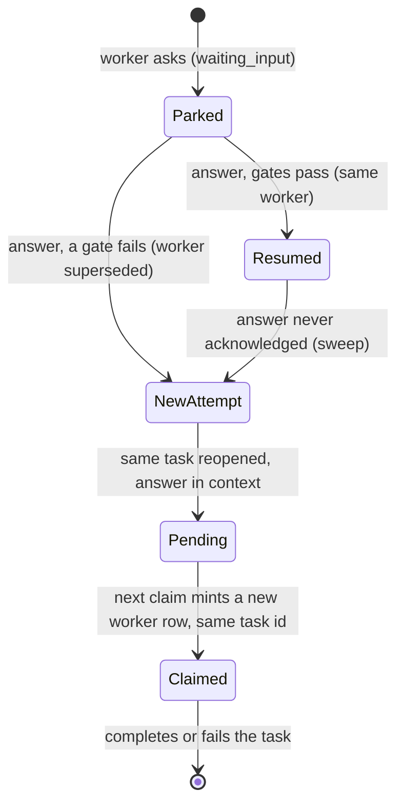

# Answered-Question Resume

**Capability statement**: A worker that stopped to ask a person is a healthy
session, not a failure. When its question is answered, the coordination layer
MUST resume that same worker's own session — same task, same worker row, same
worktree, same conversation — whenever the runner still holds it; MUST fall back
to a cold continuation ONLY for a reason it records and shows the owner; and
MUST refuse to resume into a context ceiling or an unhealthy backend credential
rather than discovering either as a death.

**Whatever path runs, the task is the same task.** A cold continuation is a new
**execution attempt** (a new worker row) of the answered task, never a new
task: one task id, one mission slot, one dependency node, through an answer, a
cold restart, a lost runner and every retry after them. See "One task, many
attempts".

`docs/specs/human-in-the-loop-protocol.md` defines who may answer and what an
answer is. This spec defines **what happens to the session afterwards**.

---

## Why this is a distinct question from retry resume

Two earlier audits DROPped session resume. Both judged it for **post-failure
retries**: a session that died is resumed into the state that killed it, at
4–10× the first-turn token cost of a cold start, with the context-exhaustion
class immediately fatal. Those verdicts stand for retries and are not reopened
here.

A parked question is a different class on every axis that decided them:

| | Post-failure retry | Answered question |
|---|---|---|
| Why the session ended | it failed | it asked, correctly |
| What the cold start is missing | a root cause that `failureContext` already carries | every judgement the agent made across the whole session, none of which is recorded anywhere |
| Is the prior transcript safe to inherit | often not (loop-guard, context kill) | yes — nothing went wrong in it |
| Does the worktree survive | no; the runner cleans it on a failed exit | **yes** — the runner keeps the worktree of a `waiting` worker alive on purpose |
| Is there a cheaper substitute | yes (branch + failure excerpt + a reasoning digest) | no; the answer is a reply to a conversation |

The cold path's own inheritance is the task itself (it is the same row), the
question and answer in `context.answeredQuestions`, and `context.resumeBranch`.
That branch only resolves if the parked worker had already **pushed** — a
question asked before the first `create_pr` leaves no remote branch, and the
runner cuts a fresh worktree from the base instead. So on the common case the
cold path inherits neither the reasoning nor the unpushed work.

---

## The decision, taken once, at answer time

**Invariants**:
- `POST /api/workers/[id]/respond` MUST classify every accepted answer into
  exactly one path — `resume`, `interactive` or `cold_continuation` — by
  calling `evaluateAnswerPath` (`apps/web/src/lib/answer-resume.ts`), and MUST
  record the resulting `path` and `reasonCode` on the task's
  `context.answerDelivery` before returning. There is no other outcome and no
  unrecorded outcome. `interactive` applies only to an interactive worker
  (`workers.runner = 'mcp'`) and is decided by gate G0 before every other gate;
  see "The interactive path".
- `evaluateAnswerPath` MUST be a pure function of server-visible facts. It
  performs no I/O, so the decision is reproducible from the recorded inputs and
  testable without a database.
- The path is `resume` if and only if ALL five gates below hold. Any single
  failing gate yields `cold_continuation` carrying that gate's `reasonCode`.
  Gates are evaluated in a fixed order so a row failing several reports the
  most fundamental one.

| Gate | Condition | `reasonCode` when it fails |
|---|---|---|
| G1 parked | `workerStatus === 'waiting_input'` | `worker_not_parked` |
| G2 transcript held | `now − workerUpdatedAt ≤ RESUME_RUNNER_FRESH_MS` | `runner_not_holding_transcript` |
| G3 confirmable | `supportsInstructionAck === true` | `runner_cannot_confirm_delivery` |
| G4 headroom | `workerTurns ≤ RESUME_MAX_TURNS`, or `waitingForType === 'permission'` | `context_ceiling` |
| G5 credential | preflight returned `ok` or `unknown` | `credential_unhealthy` |

A **revoked** credential is handled before the gates rather than by them: the
answer is refused with `409` and nothing is written (see the credential
preflight section). The gates decide between resuming and going cold; a revoked
credential means neither can run, so there is nothing for them to decide.

**G1 — parked, not merely question-bearing.** `/respond` is deliberately
status-agnostic for a question (it gates on `waitingFor` alone, so an answer is
never swallowed by a worker that also went `error`/`failed`). Resume is not.
A permission prompt is the exception — see "Permission prompts" below.
`startSession`'s `finally` block in `apps/runner/src/workers.ts` preserves the
worktree only for a worker whose local status is `done` or `waiting`; every
other exit deletes it. A worker carrying `waitingFor` on an `error` row
therefore has no worktree left to resume into, however recent it is.

**G2 — the runner that holds the transcript is the runner that will act.**
Transcripts are node-local (`~/.claude/projects/` for Claude; the stable
per-worker `CODEX_HOME` for Codex) and so is the worktree. `workers.updatedAt`
is the exact signal for "that node still holds this worker": the owning runner
re-syncs every `waiting` worker on its 10s cycle and no other runner ever syncs
it. `RESUME_RUNNER_FRESH_MS` is set at 9× that cycle so a few dropped syncs do
not cost a resume.

This gate is also why the platform needs no runner-affinity queue and pays no
queue latency for it: the answer is not dispatched as claimable work at all. It
is queued on the worker row itself, and only the runner holding that worker
ever reads it. The cost of the design is the opposite one — a resume is
possible only while that node is up, which is precisely what G2 tests.

**G3 — an unconfirmable delivery is indistinguishable from silence.** Only a
runner that speaks the delivery-confirmation protocol
(`workers.supportsInstructionAck`) reports back that the answer reached the
session. Without that acknowledgement there is no way to tell a resumed session
from an answer that vanished, and the platform would have to guess. It refuses
to guess.

**G4 — the context ceiling is decided, not discovered.** A session parked deep
into a long run may resume at or near the model's context limit and die within
a turn or two; that is the first resume audit's strongest finding and it is not
reopened. The server holds no direct measure of a resumed transcript's token
size — `workers.inputTokens` is cumulative across turns and `workers.resultMeta`
is written only at a terminal state, which a parked worker is not — so
`workers.turns` is the declared proxy and `RESUME_MAX_TURNS` the declared
threshold. Above it the platform goes cold **deliberately**, says so, and the
owner sees `context_ceiling` as the reason.

Below the threshold the platform does not rely on luck either: the CLI's own
auto-compaction is the mechanism that keeps a resumed session inside its window
(the agent SDK's context report exposes isAutoCompactEnabled and
autoCompactThreshold; both are SDK-side, not buildd symbols), and the runner
MUST NOT disable it. Requesting a compaction
ourselves at resume time would be strictly worse — the transcript is
materialised before any instruction of ours can run, so a self-issued compact
cannot prevent an over-ceiling load; only not resuming can.

G4 does not apply to a permission prompt. Nothing is resumed there: the
runner's `PermissionRequest` hook is blocked inside the still-running session,
and the queued answer resolves that hook (`sendMessage` → `resolvePermission`
in `apps/runner/src/workers.ts`). Transcript size cannot matter. Applying G4
anyway superseded a live session thousands of turns deep and gave a fresh
continuation a bare "Allow once" it had no context for.

**G5 — a parked session may have sat for hours.** See the credential preflight
section below. G5 covers the recoverable case only — a token that is expired and
could not be refreshed. A revoked credential never reaches the gates.

**Acceptance criteria**:
- AC-1: GIVEN a worker with `status: 'waiting_input'`, `updatedAt` 5s old,
  `supportsInstructionAck: true`, `turns: 40` and a credential preflight of
  `ok` WHEN `evaluateAnswerPath` runs THEN it returns
  `path: 'resume'`, `reasonCode: 'resume_eligible'`.
- AC-2: GIVEN the same worker with `status: 'error'` THEN the result is
  `path: 'cold_continuation'`, `reasonCode: 'worker_not_parked'`.
- AC-3: GIVEN the same worker with `updatedAt` older than
  `RESUME_RUNNER_FRESH_MS` THEN the result is `path: 'cold_continuation'`,
  `reasonCode: 'runner_not_holding_transcript'`.
- AC-4: GIVEN the same worker with `supportsInstructionAck: false` THEN the
  result is `path: 'cold_continuation'`,
  `reasonCode: 'runner_cannot_confirm_delivery'`.
- AC-5: GIVEN the same worker with `turns` above `RESUME_MAX_TURNS` THEN
  the result is `path: 'cold_continuation'`, `reasonCode: 'context_ceiling'`.
- AC-6: GIVEN the same worker with a credential preflight of `unhealthy`
  THEN the result is `path: 'cold_continuation'`,
  `reasonCode: 'credential_unhealthy'`.
- AC-7: GIVEN a worker failing G1 AND G4 simultaneously THEN the reported
  `reasonCode` is `worker_not_parked` — gate order is fixed, so the reason a
  reader sees is stable rather than dependent on evaluation order.
- AC-8: GIVEN a credential preflight of `unknown` (no managed credential
  row — the account supplies its own key) THEN G5 passes and the path is
  `resume`; an absent credential MUST NOT be read as a broken one.

**Code surface**:
- `apps/web/src/lib/answer-resume.ts` — `evaluateAnswerPath`,
  `RESUME_RUNNER_FRESH_MS`, `RESUME_MAX_TURNS`, `RESUME_ACK_DEADLINE_MS`,
  `ANSWER_PATH_REASONS`, `buildAnsweredAttemptContextPatch`
- `apps/web/src/app/api/workers/[id]/respond/route.ts` — the call site
- `apps/runner/src/workers.ts` — the `finally` block that preserves a `waiting`
  worker's worktree, and the 10s sync that keeps `updatedAt` fresh
- `apps/runner/src/worker-sync.ts` — `consumeInstructions` on every waiting
  worker's sync

---

## Permission prompts and stale cards

**Decision: a background runner session's permission request DOES surface to
the owner**, as a `waitingFor` of `type: 'permission'` with Allow once / Deny,
but only while the session is blocked on it. It is a live hook, not a parked
question. The prompt means nothing once the session ends: the runner resolves
the pending hook as deny when it aborts. So:

- `isAnswerableWaitingFor` (`apps/web/src/lib/answer-resume.ts`) is the single
  rule. A question is answerable whenever `waitingFor` is set. A permission
  prompt is answerable only while `workerStatus === 'waiting_input'`. The task
  page renders a needs-input card only when this holds, and `/respond` refuses
  when it does not, so a card that is shown can be answered.
- `PATCH /api/workers/[id]` clears a `permission` `waitingFor` when the worker
  reaches a terminal status. The runner's abort path reports only the status.
- A cold continuation is never created from a permission answer on an ended
  worker. A fresh session would receive "Allow once" with nothing to allow.

**A stale card gets a reason, not a gate name.** When `/respond` finds nothing
answerable, it returns `400` with `reasonCode` (`already_answered` |
`worker_ended` | `no_longer_waiting`), a plain-language `error`, and a
`nextAction` (`open_task` with the continuation's `taskId` | `follow_up` |
`refresh`) from `explainNotWaiting`. The task page shows that message and link,
then refetches so the stale card goes away.

**Other open views are told.** The cold path supersedes the worker outside the
PATCH route, so it emits its own `worker:progress` with `status: 'superseded'`
on the worker and task channels. That is the status change open views refresh on
immediately. Before this, a second device kept showing a question that had
already been answered.

**A stale tap after a new attempt stays on the task.** A `superseded` worker with
no `continuationTaskId` was answered onto a new attempt of its own task, so
`explainNotWaiting` says so and returns `nextAction: { kind: 'refresh' }`, and
the recorded answer is read from the task's own `context.answeredQuestions`. A
`superseded` worker WITH a `continuationTaskId` is a legacy record (below) and
keeps its `open_task` link.

**Acceptance criteria**:
- AC-28: GIVEN a `waiting_input` worker with a `permission` prompt, a fresh
  sync, ack support and `turns` far above `RESUME_MAX_TURNS` WHEN answered THEN
  the path is `resume` and no continuation task is inserted.
- AC-29: GIVEN a `failed`/`error`/`completed` worker still carrying a
  `permission` prompt WHEN answered THEN `/respond` returns `400`,
  `reasonCode: 'worker_ended'`, and writes nothing.
- AC-30: GIVEN a `superseded` worker with a `continuationTaskId` (a legacy
  record) WHEN answered THEN the reply carries `reasonCode: 'already_answered'`
  and `nextAction: { kind: 'open_task', taskId }`.
- AC-56: GIVEN a `superseded` worker with no `continuationTaskId`, whose task's
  `context.answeredQuestions` holds its answer WHEN answered again THEN the
  reply carries `reasonCode: 'already_answered'`, `nextAction: { kind:
  'refresh' }`, the task's own id, and `recordedAnswer` equal to that answer.
- AC-31: GIVEN a terminal status PATCH for a worker carrying a `permission`
  prompt THEN `waitingFor` is cleared. A `question` prompt is kept.

---

## The resume path

**Invariants**:
- A resumed answer MUST keep the **same task and the same worker row**. No
  `Continue:` task is created, the worker is NOT marked `superseded`, and no
  second worker row is inserted. One continuous record — turns, cost, feed,
  instruction history — is the point: a parent plus a `Continue:` child splits
  every one of those in half and the split is unrecoverable afterwards.
- Because the worker stays the same worker, it later reaches a real terminal
  state (`completed` or `failed`) and is counted honestly by
  `get_failure_analytics` and success-rate-by-role. The `superseded` status and
  its analytics exclusion (`IN_FLIGHT_WORKER_STATUSES` in
  `apps/web/src/lib/failure-analytics.ts`) remain correct and remain in use —
  on the cold path only, where they describe what actually happened: that
  attempt was replaced by a new attempt of the same task.
- The answer MUST be delivered through the existing acknowledged instruction
  queue, not a new invocation: `enqueuePendingInstruction` +
  `appendInstructionHistory` with `deliveryState: 'pending'`
  (`apps/web/src/lib/worker-instructions.ts`), plus the urgent
  `WORKER_COMMAND` push. This is the wiring the runner already drains into
  `sendMessage` → `resumeSession` (`apps/runner/src/recovery.ts`), which routes
  Claude by `worker.sessionId` and Codex by `worker.codexThreadId` and falls
  back to reconstructed context if the SDK resume throws. Owner-visible
  behaviour is identical for both backends.
- The resume invocation MUST NOT combine a session id with a resume id. The CLI
  rejects `--session-id` alongside `--resume` without `--fork-session`, and that
  pair once turned every steering message on a resumed worker into a crash.
  `ClaudeBackend.runStreamed` deletes `sessionId` from the query options
  whenever `resume` is present; the answer path reaches the SDK through exactly
  that code and adds no invocation of its own.
- `waitingFor` MUST be cleared in the same compare-and-swap that claims the
  answer, so a second answerer gets HTTP 409 on the resume path exactly as on
  the cold path.
- The worker's status MUST NOT be changed by `/respond` on this path. It stays
  `waiting_input` until the runner reports `running` for the resumed session.
  Writing `running` from the coordination layer would claim a session start
  that has not happened.
- **A parked or resumed session MUST NOT emit a terminal record.** The
  `workerTerminalRecords` ledger is one row per worker, `workerId` unique with
  `onConflictDoNothing` (`packages/core/terminal-records.ts`), so a row written
  at park time would be the FIRST writer and would silently swallow the resumed
  session's real outcome — the failure mode is a lost measurement, not a
  duplicate. Three properties keep this true and each is load-bearing:
  `isTerminalStatus` in `PATCH /api/workers/[id]` covers only
  `completed`/`failed`/`error`, so `waiting_input` fires nothing; the runner's
  startup reconciliation rewrites only `working`/`stale` (and
  `killedByRestart`, which `loadAllWorkers` sets only for `working`), so a
  restart does not crash-reconcile a parked worker; and `/respond` writes no
  status here. A resumed worker therefore reaches exactly one terminal record,
  at its real end, carrying the whole session's turns and cost rather than the
  pre-answer half.
- The cold path's `superseded` write and the unacknowledged-answer sweep
  produce no terminal record either, because `superseded` is not an
  `isTerminalStatus` and neither write goes through the PATCH route. That is a
  gap in the terminal ledger's own coverage rather than in this contract — a
  superseded worker did not end a session, it was replaced — and it predates
  this capability. Recorded here so a future reader does not read the silence
  as this path's bug.
- The worktree MUST be the one the parked session left, including unpushed
  commits and uncommitted changes. The runner resumes into `worker.worktreePath`
  when it still exists; it survived because the park kept the worker's local
  status at `waiting`, and a waiting worker is never evicted. This is the
  guarantee the cold path cannot make at all: `context.baseBranch` resolves only
  against a branch that was already pushed, and discards uncommitted work in
  every case.

**Acceptance criteria**:
- AC-9: GIVEN a resume-eligible parked worker WHEN `POST /respond`
  succeeds THEN no row is inserted into `tasks`, the response carries
  `path: 'resume'` and the original task id, and the worker's `status` is
  unchanged.
- AC-10: GIVEN the same call THEN the worker's `pendingInstructions`
  contains the answer text and a new `instructionHistory` entry carries
  `deliveryState: 'pending'` — never `'delivered'`, which only the runner's
  acknowledgement may write.
- AC-11: GIVEN the same call THEN the worker's `status` is NOT
  `superseded` and `completedAt` is not set.
- AC-12: GIVEN a worker whose `waitingFor` is already null WHEN `POST
  /respond` is called THEN HTTP 400 and nothing is queued — the resume path
  offers no second way past the single-answer guard.
- AC-13: GIVEN two concurrent answers to the same resume-eligible worker
  THEN exactly one receives HTTP 200 and the other HTTP 409, and the answer is
  queued exactly once.

**Code surface**:
- `apps/web/src/app/api/workers/[id]/respond/route.ts`
- `apps/web/src/lib/worker-instructions.ts` — `enqueuePendingInstruction`,
  `appendInstructionHistory`, `markInstructionsDelivered`
- `apps/runner/src/recovery.ts` — `resumeSession` (Layer 1 SDK resume by
  backend-appropriate id, Layer 2 reconstructed context)
- `apps/runner/src/backends/claude-backend.ts` — the `resume`/`sessionId`
  exclusion
- `apps/runner/src/backends/codex-backend.ts` — `resumeThreadId` →
  `codex.resumeThread`

---

## The interactive path

A worker minted by `claim_task` from a person's own MCP session
(`workers.runner = 'mcp'`), parked on a question by that session, is held by no
runner. RESUME would queue an answer no runner drains; COLD would hand live
local work to a runner. So it gets its own path.

**Invariants**:
- G0 (`evaluateInteractiveAnswerPath`) runs before G1–G5. It returns nothing
  for a runner-managed worker. For an interactive worker it returns
  `interactive` / `interactive_session` when the worker is parked
  (`waiting_input`) however old its `updatedAt` is, or when it is `running`,
  `idle` or `starting` with `updatedAt` within `INTERACTIVE_WORKER_IDLE_TTL_MS`;
  otherwise `cold_continuation` / `interactive_session_gone`. A gone
  interactive session MUST NOT be resumed on a runner.
- The one exception to "parked is live" is the poll heartbeat (below): a
  parked worker whose `waitingFor.sessionSeenAt` is older than
  `INTERACTIVE_SESSION_POLL_STALE_MS` (5 min) goes `cold_continuation` /
  `interactive_session_stopped_polling`. A parked worker with no heartbeat at
  all stays live: never having polled is not evidence the session is gone.
- A parked interactive worker's `updatedAt` is frozen at the ask, so the
  waiting_input sweep measures the park from it. That sweep, not the idle TTL,
  owns a parked session's expiry: once it fails the worker, G0 sends the answer
  cold.
- `/respond` takes G0 BEFORE the backend credential preflight: the session
  runs on the person's own seat, so the workspace's managed credential (even a
  revoked one) MUST NOT refuse or reroute an answer to it. A gone session's
  cold continuation runs on a runner and is preflighted as usual.
- The interactive path claims the answer with the same CAS on `waitingFor`,
  sets `status: 'running'`, clears `waitingFor`, appends an
  instruction-history entry (`deliveryState: 'pending'`), and enqueues an
  `answer` worker message (`enqueueWorkerMessage`) on the worker's own task
  with `body: { source: 'human', text, question?, workerId }`. The history
  entry and the message share one id. It creates no task, wakes no runner and
  releases no path claim.
- The session receives it from `receive_messages` (or `update_progress`),
  rendered as `**HUMAN ANSWER** to your question "…": …`. Its
  `workerMessagesDelivered` ack also acknowledges the history entry with that
  id (`PATCH /api/workers/[id]`).
- Until that ack, a second tap on the running worker is `already_answered`
  (`explainNotWaiting` with `interactive`), carrying the recorded answer.
- When the message cannot be queued, the question, status and history are
  restored and the call fails 500, so the answer can be given again.
- `answerDelivery` carries no `ackDeadlineAt`: the unacknowledged-resume sweep
  only degrades `resume`. It does carry `messageId`, the id of the `answer`
  message and its history entry, and is merged into the live `tasks.context`
  in SQL — never written as a spread of the context read before the enqueue,
  which deleted the just-queued answer.

### Waiting for the answer: `await_answer`

**Invariants**:
- `await_answer { workerId?, waitSeconds? }` (MCP, worker level,
  `workers:write`) calls `POST /api/workers/[id]/answer`, which long-polls
  server-side for at most 45 s (default 40; a longer or malformed wait is
  clamped, never rejected), the same shape as `get_pr_review`'s `waitSeconds`.
  Only the worker's owner (or a per-task token for its task) may call it.
- The answer is read from the durable record (`readInteractiveAnswer`):
  `answerDelivery` with `path: 'interactive'`, this `workerId` and a
  `messageId`, whose instruction-history entry is not yet `acknowledged`. The
  text comes from that entry, or from the queued message when the entry kept
  none (sensitive workspace). An answer still queued without a delivery
  record is found too. The capped queue is never the only source.
- The route does not ack. The tool acks by id with
  `workerMessagesDelivered: [messageId]` — the ack `receive_messages` sends —
  so the answer is returned once, whichever of the two reads it first. A
  failed ack leaves it unread and it is returned again.
- A timeout returns `{ timedOut: true, stillWaiting: true }`; the session
  calls again. A worker no longer waiting returns `stillWaiting: false` with a
  `reasonCode`: `session_ended` (terminal; `continuationTaskId` when the
  answer went cold) or `no_question`. A runner-managed worker is refused
  (`not_interactive`).

### Waiting at no cost: `waitCommand`

The `await_answer` loop costs one model turn per 45 s. Claude Code wakes a
session when a `run_in_background` Bash command exits, so ask_human hands back
a shell command that does the waiting instead.

**Invariants**:
- After parking, ask_human calls `POST /api/workers/[id]/answer/capability`
  (owner or per-task token, interactive worker in `waiting_input` only; else
  403/409; 503 with no signing secret) and returns its `waitCommand` and
  `waitExpiresAt`. A failed mint never fails the ask: the reply drops
  `waitCommand` and the hint points at `await_answer`.
- The mint stamps a fresh random ask id on the live question
  (`waitingFor.waitCapId`, a `jsonb_set` gated like the heartbeat; never moves
  `updated_at`) and signs `bldw_<{w: workerId, a: askId, e: expiresAtMs}>.<HMAC>`.
  The key is HKDF-SHA256 over the existing server secret (`AUTH_SECRET`, else
  `NEXTAUTH_SECRET`, else `ENCRYPTION_KEY`, the presence-token and
  interactive-session precedence) under its own label
  `answer-wait-capability`; comparison is constant-time. No new env var, no
  table: expiry is the park deadline (park time + 24 h, 4 h in a mission).
- `/respond`'s interactive path copies `waitCapId` into `answerDelivery`.
- `POST /api/workers/[id]/answer/wait` accepts ONLY that capability, in the
  `x-buildd-wait-cap` header (never the query string). It answers status
  only, never the answer or question: `{ answered: true, state: 'answered' }`
  when the unread answer's `answerDelivery.waitCapId` is this ask;
  `{ answered: false, state: 'waiting', retryAfter }` after a long-poll of at
  most 45 s (bounded by the capability's expiry); `{ answered: false, state:
  'ended', reason }` for an ended worker. 401 `{ reason }` for a missing,
  tampered, expired or other-worker capability, and `superseded` once a newer
  ask replaced the question or its answer was read. 403 for a runner-managed
  worker, 404 for none.
- Every wait call on a parked worker records the poll heartbeat
  (`recordInteractiveSessionSeen`), so a closed terminal still goes cold after
  5 min, and never restarts the park clock.
- `waitCommand` is `sh -c '<script>' buildd-wait '<waitUrl>' '<capability>'
  <deadlineEpochSeconds>`: POSIX sh + curl, never the buildd CLI, no bearer
  token. Exit 0 answered; 1 curl missing; 2 deadline passed; 3 capability
  refused; 4 worker ended or gone, each non-zero with one line saying why.
  Network errors, 429 and 5xx retry (2 s, then 30 s), bounded by the deadline.
  On exit 0 the session calls `await_answer { waitSeconds: 0 }`, which reads
  and acks the answer as above. The `await_answer` loop stays the fallback for
  clients without background commands.

**Acceptance criteria**:
- AC-42: GIVEN a minted capability WHEN it is used for another worker,
  after its expiry, tampered with, or after a newer ask THEN the wait route
  answers 401 and reads nothing for the first three.
- AC-43: GIVEN the answer to the capability's ask WHEN the wait route is
  called THEN `{ answered: true, state: 'answered' }` and the body contains
  neither the answer nor the question.
- AC-44: GIVEN the generated `waitCommand` against a stub that answers
  "waiting" then "answered" THEN it exits 0, sending the capability header on
  every call; a 401 exits 3 with one line, a passed deadline exits 2 without
  calling.

### The poll heartbeat

**Invariants**:
- Every `await_answer` call and every `consumer: 'agent'` PATCH
  (`receive_messages`) on a parked interactive worker stamps
  `waitingFor.sessionSeenAt` (`recordInteractiveSessionSeen`). It is its own
  `UPDATE … SET waiting_for = jsonb_set(…)` gated on `runner = 'mcp'`,
  `status = 'waiting_input'` and `waiting_for IS NOT NULL`: it does not touch
  `updated_at` (the park clock) and cannot resurrect a question an answer has
  just cleared. No schema change: `waitingFor` is jsonb.
- `INTERACTIVE_SESSION_POLL_STALE_MS` is 5 min: over 6x the 45 s wait (a slow
  turn, a dropped call and a retry fit), above the ~3 min `update_progress`
  cadence the skills ask for, and far below the 2 h idle TTL.

### Expiry of an unanswered interactive question

**Invariants**:
- The waiting_input sweep (`cleanupStuckWaitingInput`) still owns expiry
  (24 h, 4 h in a mission) and still fails the worker (`exitCause:
  'needs_input'`).
- Where the task may be retried, the sweep requeues the SAME task for a new
  attempt (the shape of `reopenTaskForAnsweredAttempt`: `pending`, unclaimed,
  woken as `task.requeued`) and never inserts a clone: the mission grows no
  task, the original is not left `failed`, `resolveCompletedTask` is not run on
  it, and the description is not rewritten. The "do not ask again" guidance
  travels as `context.unansweredQuestion` (`{ workerId, prompt, options,
  expiredAt }`), which the runner's prompt builder renders as an
  `unanswered-question` section; `iteration` and the branch context are bumped
  as on every requeue. The write is merged into the live context in SQL and
  guarded to a task still open and not kernel-merged: a task cancelled or
  merged in the window stays as it is and nothing is woken.
- A delivery-owner task is ended through the kernel (`AttemptEnded(lost)`) as
  before; a kernel-linked non-owner task is failed, with no clone.
- For an interactive worker the task is NOT requeued, and stays failed, unless the task's mission
  is `executor = 'local'`. A person chose to run that work in their own
  session; a retry on a runner mission is claimable by a background runner,
  which would rebuild the work behind them. A local mission's retry is only
  claimable by a person's session, the arrangement the original claim had.
  The worker's error says it was not retried and how to pick it up again.

**Acceptance criteria**:
- AC-37: GIVEN `/respond` answered an interactive worker and the queue
  then evicted the message WHEN `await_answer` THEN it returns the answer
  text, and its ack marks the history entry `acknowledged`; a second call
  returns `stillWaiting: false`.
- AC-38: GIVEN no answer WHEN `await_answer { waitSeconds: 300 }` THEN
  the server waits at most 45 s and returns `timedOut: true, stillWaiting: true`.
- AC-39: GIVEN a parked interactive worker whose `sessionSeenAt` is older
  than 5 min WHEN `POST /respond` THEN `path: 'cold_continuation'`,
  `reasonCode: 'interactive_session_stopped_polling'`. With no
  `sessionSeenAt`, or a recent one, THEN `path: 'interactive'`.
- AC-40: GIVEN a parked interactive worker WHEN `receive_messages` THEN
  `waitingFor.sessionSeenAt` is stamped and `updated_at` is unchanged.
- AC-41: GIVEN an interactive worker's question past the sweep's
  threshold THEN the worker and task fail and the task is not requeued;
  on an `executor = 'local'` mission the same task is requeued (AC-58).
- AC-58: GIVEN a question nobody answered past the sweep's threshold on a plain
  task WHEN the sweep runs THEN no task row is inserted, the same task is
  `pending` and unclaimed with `task.requeued` woken, its title, description,
  role, dependencies and parent are untouched, and `context.unansweredQuestion`
  carries the question and options.
- AC-59: GIVEN that requeue WHEN the task was closed or merged in the window
  THEN the guarded write moves nothing, nothing is woken and it is not counted.
- AC-60: GIVEN a task with `context.unansweredQuestion` WHEN the runner builds
  its prompt THEN an `unanswered-question` section names the question and
  tells the attempt not to ask for input.

### An answer the session never reads

The interactive path flips the worker to `running` the moment the answer
lands, so a session that dies between the answer and its next poll leaves the
answer on a `running` worker that neither the park expiry nor the resume
sweep looks at.

**Invariants**:
- `cleanupUnreadInteractiveAnswers` sends the answer to a cold continuation
  (`reasonCode: 'interactive_answer_not_read'`) when ALL hold: the worker is
  `runner = 'mcp'` and `running`; `answerDelivery` is `path: 'interactive'`
  for this worker with a `messageId`; that instruction-history entry is not
  `acknowledged`; and the worker's `updatedAt` is older than
  `INTERACTIVE_ANSWER_READ_DEADLINE_MS` (15 min).
- The clock is the worker's last activity, not the answer: the answer itself,
  any `update_progress` and every plugin presence touch move `updatedAt`, so a
  session that is busy and checking in is never overtaken. The claiming write
  re-checks `status = 'running'` and the quiet `updatedAt`; a session that
  reads the answer or checks in first wins.
- The worker is superseded, the answer leaves the task's message queue, and the
  same task is reopened for a new attempt carrying the answer (see "One task,
  many attempts"). A session that comes back gets `session_ended` from
  `await_answer` (no `continuationTaskId`: the work stays on this task), a 401
  from the wait route and an abort from every worker PATCH, so it cannot act on
  the answer alongside the new attempt.
- If reopening the task fails, the worker goes back to `running` with the
  answer still readable; a later pass retries.
- The plugin's turn-boundary nudge covers a queued answer (`hasUnreadAnswerFor`
  in `lib/local-session.ts`), not only `pendingInstructions`: a live session
  that stopped waiting is told to call `receive_messages` at its next prompt,
  tool call or stop.
- Both answer sweeps run from `POST /api/tasks/cleanup` (each runner's timer)
  and from the declared `waiting-input-sweep` cron, so an account whose runners
  are all down is still covered.

**Acceptance criteria**:
- AC-45: GIVEN an interactive answer unread and the worker quiet for over
  15 min WHEN the sweep runs THEN no task is inserted, the worker's own task is
  reopened `pending` with the answer in `context.answeredQuestions` and
  `reasonCode: 'interactive_answer_not_read'`, the worker is superseded with no
  `continuationTaskId`, and the message leaves the task's queue.
- AC-46: GIVEN the same answer with the worker active within 15 min, or
  the entry `acknowledged` THEN the sweep leaves it alone.
- AC-47: GIVEN a superseded worker whose answer is still unread WHEN
  `await_answer` THEN `session_ended`, never the answer (with the continuation
  id only for a legacy record that has one).
- AC-48: GIVEN an answer queued for a bound worker WHEN a presence touch
  THEN the response flags `pendingInstructions: true`.

**Acceptance criteria**:
- AC-32: GIVEN an interactive worker in `waiting_input` checked in within
  the idle window WHEN `POST /respond` THEN `path: 'interactive'`, no task is
  inserted, one `answer` message is queued on the worker's task, and the worker
  write sets `status: 'running'` and `waitingFor: null`.
- AC-33: GIVEN the same worker and a revoked managed credential THEN the
  answer is accepted on the interactive path and no preflight runs.
- AC-34: GIVEN a `running` interactive worker past the idle window, or a
  `failed` / `error` one, THEN `path: 'cold_continuation'`, `reasonCode:
  'interactive_session_gone'`.
- AC-36: GIVEN an interactive worker in `waiting_input` whose `updatedAt`
  is 3h old (past the idle window) WHEN `POST /respond` THEN `path:
  'interactive'`, and no continuation task is inserted.
- AC-35: GIVEN a `workerMessagesDelivered` ack naming an instruction-history
  entry's id THEN that entry is `acknowledged`.

---

## The cold fallback: a new attempt of the same task, and why it is loud

**Decision: a cold continuation is a new execution attempt of the answered
task, not a new task.** It used to insert a `Continue: <title>` task. That gave
one piece of work two identities: a mission grew a task card the owner never
planned, its progress counters grew by one, the dependency graph pointed at a
task that would never finish (the parent stayed open forever, so its dependents
waited on a node nobody was working), and the attempt history split across two
task pages. A runner losing a session is an attempt ending, exactly as a crash
retry is, and the platform already had one shape for that: the task goes back to
`pending` and the next claim mints a new worker row under the same task id. The
cold path now uses that shape.

**Invariants**:
- The cold path MUST NOT insert a row into `tasks`. It supersedes the answered
  worker and reopens that worker's own task for a new attempt through
  `reopenTaskForAnsweredAttempt` (`apps/web/src/lib/answer-attempt.ts`), the
  single writer `/respond` and both answer sweeps share.
- The answered worker is marked `superseded` (not `completed`, not `failed`)
  with `waitingFor = null`. It ended an attempt; it did not finish or fail the
  task, so it stays out of both buckets of `get_failure_analytics` and
  success-rate-by-role (`IN_FLIGHT_WORKER_STATUSES`). The new attempt is a new
  worker row that reaches its own real terminal state and is counted honestly.
  `continuationTaskId` is NOT written: there is no other task to point at.
- Reopening sets `status: 'pending'`, clears `claimedBy` / `claimedAt` /
  `expiresAt` and strips a stale force-claim, exactly as an auto-retry requeue
  does, so the claim route schedules it like any queued task: role routing,
  runner preference, held and local-executor missions, credentials and
  capability checks all apply to the new attempt unchanged. A delivery owner
  task (`deliveryRole = 'owner'`) is not moved by this statement: its status is
  the workflow kernel's, so the reopen writes only its context and then asks the
  kernel to move it — `requeueOwner` (AttemptRequeued) for an open task,
  `reopenOwner` (AttemptReopened, naming the superseded attempt and its end) for
  a failed one.
- Reopening is gated in SQL. It moves the task only when it is not `completed`
  or `cancelled`, was not merged by the kernel, and has no other live worker
  (another attempt already running means this answer is not the one carrying the
  work). An answer that cannot reopen its task is refused, not dropped: see
  "Compensation" below.
- Everything the work is, it keeps, because it is the same row: workspace,
  mission, `roleSlug`, `dependsOn`, `pathManifest`, `delegation`,
  `outputRequirement`, `outputSchema`, `backend`, `runnerPreference`, priority,
  and the branch name, which the claim route derives from the task id. Nothing
  is copied, so nothing can be dropped in the copy — the class of bug the old
  continuation's field-by-field inheritance list existed to fight.
- What the attempt adds is merged into the live `tasks.context` in SQL (never a
  spread of a stale read):
  - `answeredQuestions`: appended `{ id, workerId, question, answer,
    milestones, branch, reasonCode, reason, answeredAt }`, the newest
    `ANSWERED_QUESTIONS_KEEP` kept. The answer is durable here; nothing the
    person typed lives only on a worker row that has ended.
  - `resumeBranch` (and `baseBranch` where `requeueBranchContext` sets it) =
    the superseded worker's branch, and `lastCommitSha` when known: the same
    branch continuity every retry requeue writes.
  - `iteration + 1`, and `answerDelivery` with `continuation: 'same_task'`.
- The new attempt is told. The runner's prompt carries an `answered-question`
  section built from `context.answeredQuestions`: each question, the person's
  answer verbatim, and the instruction to act on it rather than ask again.
- Mission bookkeeping cannot move. No task is inserted, so a mission's task
  count, its progress fraction and its topological order are what they were;
  the reopened task is not `completed`, so no dependent is unblocked until the
  new attempt actually completes it.
- Path claims held under the task are released (`releaseAndNotify(taskId,
  'abandoned')`) as on every requeue; the new attempt re-declares its own.
- A fallback MUST NOT be silent. Every cold fallback writes
  `context.answerDelivery` carrying `path`, `reasonCode` and a human-readable
  `reason`, AND posts one note to the task feed naming which path ran and why.
  `reasonCode` MUST come from the closed set `ANSWER_PATH_REASONS`.
- The stored path value stays `cold_continuation`. It is a queryable value
  already written on existing rows; renaming it would split one decision across
  two codes. `answerDelivery.continuation: 'same_task'` tells a new-attempt
  record from a legacy one, which carries no such key.
- A resume that is queued but never acknowledged MUST degrade to the same new
  attempt rather than waiting forever. `cleanupUnresumedAnswers`
  (`apps/web/src/lib/stale-workers.ts`) converts any worker still parked with
  its answer still queued past `RESUME_ACK_DEADLINE_MS` into the cold path with
  `reasonCode: 'resume_not_acknowledged'`, reusing the queued text as the
  answer. It is reached by `POST /api/tasks/cleanup` and the
  `waiting-input-sweep` cron, so the worst-case latency of that degradation is
  their cadence, not an instant. A slow correct fallback beats a fast wrong one.
- The sweep MUST be idempotent: once it has written `answerDelivery.path:
  'cold_continuation'` and superseded the worker, a second pass reopens
  nothing.
- **Credential unavailable is not progress.** An `unhealthy` (expired and
  unrefreshable) credential still reopens the task, so the answer is durable,
  but the reply carries `blockedOn: 'credential'` and the feed note is a
  `warning` that says the new attempt cannot start until the credential is
  reconnected. Nothing reports the work as resumed. A revoked credential is
  refused before any of this (`409`, nothing written).

### Compensation

neon-http has no transactions, so the worker write and the task write are two
statements, compensated by hand:

- `/respond` reads the task first and refuses a `completed` or `cancelled` task
  with `409 reasonCode: 'task_closed'` before writing anything, so the question
  stays parked and nothing is half-done.
- The worker CAS on `waitingFor` comes first and decides the race between two
  answers: the loser gets `409 already_answered` and writes nothing.
- If the reopen then throws, the worker is restored to its pre-answer
  `status`, `waitingFor` and `completedAt` and `/respond` answers `500`, so the
  answer can simply be given again. If the reopen moves no row (the task closed,
  or another attempt went live, in the window), the worker is restored the same
  way and `/respond` answers `409` with the reason. For a delivery owner whose
  kernel move was refused, the `answeredQuestions` entry it already wrote is
  removed by id.
- The unacknowledged-resume sweep restores the worker to `waiting_input` with
  the answer back on `pendingInstructions`; the interactive sweep restores
  `running` with the answer still readable. Either is revisited on a later
  pass.
- Once the task is reopened the answer is durable; the feed note and the
  dashboard pushes after it are best-effort and MUST NOT abort a sweep for the
  rest of that account's candidates.

### Legacy `Continue:` records

Rows written before this change keep what they recorded, and nothing rewrites
them:

- A worker with `continuationTaskId` keeps its link: the stale-card reply, the
  task page and `await_answer` still point at the continuation task.
- A legacy `Continue:` task is an ordinary task with `parentTaskId` set and
  `context.answerDelivery` without `continuation`. It runs, completes or is
  cancelled like any task.
- **No backfill.** Folding a legacy continuation back into its parent would
  move workers between tasks, rewrite PR ownership and branch names, and change
  historical mission counts after the fact; none of that is safely reversible,
  and the audit trail is worth more than tidy counts. Where a legacy parent was
  left open with no live worker and its continuation carries the work, a person
  resolves it (cancel the one not wanted); the platform does not guess which.

**Acceptance criteria**:
- AC-14: GIVEN an answer that falls back for any reason WHEN `POST
  /respond` succeeds THEN the task's `context.answerDelivery.reasonCode` is
  the failing gate's code, `answerDelivery.continuation` is `'same_task'`, and
  the response carries `path: 'cold_continuation'` and the answered worker's
  own `taskId`.
- AC-15: GIVEN the same call THEN exactly one note is posted to the task
  feed naming the path and the reason.
- AC-49: GIVEN a cold fallback WHEN `POST /respond` succeeds THEN no row is
  inserted into `tasks`; the task is `pending` with `claimedBy` null; its
  `context.answeredQuestions` ends with an entry carrying the question, the
  answer, the worker id and the reason code; `context.resumeBranch` is the
  worker's branch and `context.iteration` is the previous one + 1; the worker
  is `superseded` with no `continuationTaskId`.
- AC-50: GIVEN a mission of three tasks where task 03 depends on task 02 and
  task 02's worker is parked WHEN its answer falls back cold THEN the mission
  still has three tasks, task 02 is the same row (now `pending`), and task 03
  is still blocked on it; it is unblocked only once a later attempt completes
  task 02.
- AC-51: GIVEN a cold fallback whose task reopen throws THEN the worker is
  restored to its pre-answer status with `waitingFor` and `completedAt` back,
  the reply is `500`, and no note is posted.
- AC-52: GIVEN a task that is `completed` or `cancelled` when its question is
  answered and the answer would go cold THEN `/respond` answers `409
  task_closed` and writes nothing; the question stays answerable.
- AC-53: GIVEN a delivery owner task WHEN its answer falls back cold THEN the
  reopen statement writes no `status` and the kernel move is requested:
  AttemptRequeued for an open task, AttemptReopened naming the superseded
  worker for a failed one.
- AC-54: GIVEN a task whose `context.answeredQuestions` is set WHEN the
  runner builds a new attempt's prompt THEN it carries the question and the
  answer verbatim and tells the agent not to ask it again.
- AC-55: GIVEN an `unhealthy` (not revoked) credential WHEN the answer falls
  back cold THEN the task is reopened, the reply carries `blockedOn:
  'credential'`, and the one note is a `warning` saying the new attempt cannot
  start until the credential is reconnected.
- AC-16: GIVEN a worker parked with `answerDelivery.path: 'resume'` and
  `pendingInstructions` still set, older than `RESUME_ACK_DEADLINE_MS`, WHEN
  `cleanupUnresumedAnswers` runs THEN no task is inserted, the worker's own task
  is reopened carrying the queued answer in `context.answeredQuestions`, the
  worker becomes `superseded`, and `answerDelivery.reasonCode` is
  `resume_not_acknowledged`.
- AC-17: GIVEN the same worker after that sweep has already run WHEN it
  runs again THEN nothing is reopened or inserted a second time.
- AC-18: GIVEN a worker whose queued answer WAS acknowledged (its
  `instructionHistory` entry reads `delivered` and `pendingInstructions` is
  null) WHEN `cleanupUnresumedAnswers` runs THEN it is left alone.
- AC-19: GIVEN a worker superseded by the sweep's CAS WHEN reopening its task
  throws THEN the worker is rolled back to `status: 'waiting_input'` with the
  answer restored on `pendingInstructions`, the task is unchanged, and the
  OAuth seat is not released.
- AC-26: GIVEN a task that was reopened successfully WHEN the feed-note insert
  then throws THEN `cleanupUnresumedAnswers` does not raise, the worker still
  counts toward `degraded`, and any later candidate in the same call is still
  processed.
- AC-57: GIVEN the task page of a task whose answered worker went to a new
  attempt THEN that worker is listed in the task's attempt history as ended by
  the answer, with the recorded reason and no link to another task, and the
  task's status reads its real state (`pending` until a new attempt claims it).

**Code surface**:
- `apps/web/src/lib/answer-attempt.ts` — `reopenTaskForAnsweredAttempt`
- `apps/web/src/lib/answer-resume.ts` — `buildAnsweredQuestionEntry`,
  `buildAnsweredAttemptContextPatch`, `ANSWERED_QUESTIONS_KEEP`,
  `describeAnswerPath`
- `apps/web/src/lib/stale-workers.ts` — `cleanupUnresumedAnswers`,
  `cleanupUnreadInteractiveAnswers`
- `apps/runner/src/prompt-builder.ts` — the `answered-question` section
- `apps/web/src/app/app/(protected)/tasks/[id]/page.tsx` — the attempt row

---

## One task, many attempts

The rule this capability keeps, stated once: **a task's identity survives every
way an attempt can end.** An answer, a cold restart, a lost runner, a retry and
a hand-off each end or replace a worker row; none of them mints a task. The task
row is the mission slot and the dependency node, and the workers under it are
its attempt history, in order, each with its own honest end.

**Invariants**:
- Exactly one task row exists for the work from the first claim to the last
  attempt. Attempt history is `workers WHERE task_id = <task>` in creation
  order; nothing about an attempt is recorded only on another task.
- Each attempt's end is counted once, on its own worker row: `superseded` for
  one an answer replaced, its real `completed` / `failed` for every other.

---

## Credential preflight

An owner answered a long-parked worker and it terminated saying it was not
logged in. That is the failure this section exists to prevent.

The mechanism: the runner materialises a per-worker Claude config dir at
session start and **deletes it in the `finally` block** — which runs for a park
too — after deregistering it from the credential broker, so nothing refreshes
it while the question waits. On resume, `startSession` re-materialises it from
the broker, and if the broker has nothing it falls back to the access token
delivered at **claim** time. For a session parked for hours that token is
stale, and the resumed session dies on its first request.

**Invariants**:
- `/respond` MUST evaluate the backend credential BEFORE choosing `resume`, via
  `preflightBackendCredential`
  (`apps/web/src/lib/answer-credential-preflight.ts`). The preflight attempts a
  refresh when the stored token is expired or expires within
  `CREDENTIAL_PREFLIGHT_MARGIN_MS`, and reports the post-refresh state.
- The preflight MUST return exactly one of `ok`, `unhealthy`, `unknown`. A
  missing managed credential row is `unknown`, never `unhealthy` — accounts
  that supply their own key have no row, and reading absence as breakage would
  send every one of them down the cold path forever.
- A **revoked** credential MUST be refused outright — `409` with
  `credentialRevoked: true` — taking neither path and writing nothing, so
  `waitingFor` stays set and the question stays parked. Revoked is terminal
  until a human reconnects the account, and the claim rail already declines to
  inject a revoked credential (`credential-injection.ts`), so a cold
  continuation could not run either. Superseding the worker to create one would
  destroy the transcript and the worktree for nothing; keeping the session
  parked means the re-answer after reconnecting can still take the RESUME path.
  This is the behaviour the sibling change shipped, and resume strengthens
  rather than weakens its case.
- `unhealthy` for any OTHER reason (expired and unrefreshable) MUST NOT silently
  become a cold continuation. That state is recoverable without human action, so
  the answer is recorded durably (the task is reopened for a new attempt
  carrying it, nothing the
  human typed is lost) AND the owner is told at answer time with a `warning`
  note naming the credential.
- The preflight MUST be advisory-on-error: a refresh that throws, times out or
  returns `locked` yields `unknown`, not `unhealthy`. A transient failure of
  the credential service must not permanently route every answer cold.
- The runner MUST NOT resume a session on a claim-time access token it can see
  is already expired. When `startSession` is invoked with a resume id, the
  broker returns nothing, and the claim-delivered token's expiry is in the past,
  it MUST fail with a named error rather than spawn a session that will die
  unauthenticated. A loud failure is visible to error traces and failure
  analytics; "not logged in" 300 turns deep is not.

**Acceptance criteria**:
- AC-27: GIVEN a managed Claude credential whose `healthStatus` is
  `revoked` WHEN `preflightBackendCredential` runs THEN it returns `unhealthy`
  with `revoked: true` and attempts no refresh.
- AC-20: GIVEN a credential whose `tokenExpiresAt` is in the past WHEN the
  preflight runs THEN a refresh is attempted; if it succeeds the result is `ok`
  and if it still reports expired the result is `unhealthy`.
- AC-21: GIVEN no credential row for the team or workspace THEN the result
  is `unknown` and the answer path is unaffected.
- AC-22: GIVEN a refresh that throws THEN the result is `unknown`, not
  `unhealthy`.
- AC-23: GIVEN an `unhealthy` preflight WITHOUT `revoked` (expired and
  unrefreshable) WHEN `POST /respond` succeeds THEN the task is reopened with
  the answer in `context.answeredQuestions`
  (the answer is not dropped) AND a `warning` note naming the credential is
  posted.
- AC-24: GIVEN a resume invocation whose broker lookup returns nothing and
  whose claim-delivered token expired WHEN the runner starts the session THEN
  it throws a named credential error before spawning the agent.
- AC-25: GIVEN a preflight returning `revoked: true` WHEN `POST /respond`
  runs THEN it responds `409` with `credentialRevoked: true` and the backend
  name, no worker row is written, no task is reopened or inserted and no feed
  note is posted.

**Code surface**:
- `apps/web/src/lib/answer-credential-preflight.ts` —
  `preflightBackendCredential`, `CREDENTIAL_PREFLIGHT_MARGIN_MS`
- `apps/web/src/lib/claude-credential.ts` — `getClaudeStatus`,
  `refreshClaudeCredential`
- `apps/web/src/lib/codex-credential.ts` — `getCodexStatus`,
  `refreshCodexCredential`
- `apps/runner/src/workers.ts` — the managed-token block in `startSession`
- `apps/runner/src/broker.ts` — `fetchTokenFromBroker`

---

## Why the process is not held open instead

The obvious alternative is never to end the session at all: keep the subprocess
alive with the `AskUserQuestion` tool call unresolved and inject the answer into
the live input stream. The agent SDK supports it and so does the runner — that
is exactly what `inputAsRetry: false` does, delivering the answer as a user
message linked to the pending tool call.

It is not made the default, and the cutover rule is **zero minutes — park
immediately**:

1. **The abort is synchronous with the question.** The runner aborts inside the
   `AskUserQuestion` tool handler, before the question has been persisted long
   enough for any human to see it. There is no window in which a fast answer
   finds a live session, so a "hold live for N minutes" rule would have to
   *introduce* the hold rather than exploit one that exists.
2. **The hold is unbounded by anything the platform controls.** A parked
   question lives for up to 4h (mission) or 24h (standalone) before
   `cleanupStuckWaitingInput` reaps it. Holding a subprocess and an OAuth
   concurrency seat for a day of human latency starves every other task in the
   workspace, and the seat is the scarce resource — `maxConcurrentTasks` is
   measured in single digits.
3. **The cost of parking is now approximately zero.** The whole point of this
   spec is that the parked worker loses nothing: worktree preserved, transcript
   preserved, same worker row, same task, resumed conversation. A live hold
   buys latency, and latency was never the complaint.

`inputAsRetry: false` remains available for local and debug runs, where a human
is already watching and no seat is contended.

---

## Out of scope

- **Post-failure retry resume.** Judged by two prior audits and DROPped on
  economics and on fix quality. Nothing here reopens it; a retry is still a cold
  start with `resumeBranch` and `failureContext`.
- **Runner affinity for claimable work.** This spec deliberately avoids needing
  it by never dispatching the answer as claimable work.
- **The notification that a question was asked**, and its deep link — see
  `docs/specs/human-in-the-loop-protocol.md`.
- **Steering a running worker** (`POST /api/workers/[id]/instruct`,
  `send_agent_message`). The resume path reuses its delivery plumbing but is a
  different interaction: an answer to a question the agent asked, not an
  unsolicited redirect.
- **Making errors after an answer visible** in failure analytics and error
  traces. A sibling contract; whichever path runs here, its failures must be
  seen, and this spec assumes that separately.
- **Token cost of a resumed turn.** Resume re-injects the prior transcript and
  is more expensive per first turn than a cold start. That trade is accepted
  here on correctness grounds and bounded by G4; it is not measured by this
  spec.

---

## Verification gaps

Claims this spec deliberately does NOT make, because the code does not enforce
them.

1. **`workers.turns` is a proxy, not a measurement.** G4 approximates context
   occupancy with turn count. A session with few enormous turns passes the gate
   and can still resume near the ceiling; a session with many tiny turns is sent
   cold for no reason. Closing this needs the runner to report a context-size
   signal for a parked worker, which no current PATCH carries.
2. **`updatedAt` freshness proves a runner is syncing, not that the transcript
   file is present.** A transcript deleted out from under a live runner (disk
   cleanup, a manual `rm`) passes G2. The runner's Layer 2 reconstructed-context
   fallback catches it, so the failure mode is a degraded resume rather than a
   crash — but the owner is told `resume` ran, and Layer 2 is not `resume`.
3. **The fallback sweeps run hourly at best without a runner.** Both answer
   sweeps also run from the `waiting-input-sweep` cron, but that job fires
   hourly and only between 07:00 and 23:00 ET. With every runner for a team
   down, an answer can wait up to an hour past its deadline by day, and until
   morning overnight.
4. **No cross-channel lock.** An answer delivered through `/respond` on the
   resume path and a concurrent `/instruct` message reach the same session by
   the same queue, in arrival order, with nothing linking the records. This
   mirrors gap 13 of `docs/specs/human-in-the-loop-protocol.md`.
5. **The credential preflight reads state; it does not prove the token works.**
   A credential that is unexpired and `healthy` can still be rejected by the
   provider. Only a live verification call would prove it, and that is a
   per-answer round trip this path does not take.
6. **An idle but open session loses its answer to a follow-up.** A session
   that ended its turn without waiting (no background `waitCommand`, no
   plugin to nudge it) is indistinguishable from a dead one. After 15 quiet
   minutes its answer goes to a new attempt, even if the person later comes
   back to that terminal.
7. **The heartbeat proves the session polled, not that it will read.** A
   session that keeps calling `await_answer` but whose model never acts on the
   result looks live forever. Nothing here can tell those apart.
8. **A session that never polls is judged live.** An older client that parks
   with ask_human and never calls `await_answer` or `receive_messages` stamps
   no heartbeat, so its answer is still queued to it until the waiting_input
   sweep fails the worker — the behaviour before the heartbeat existed.
9. **The new attempt inherits only pushed work.** The same task and branch name
   are kept, but a new worker row runs in a new worktree: commits the superseded
   attempt never pushed, and its uncommitted changes, stay on that runner's
   disk. Only the resume path keeps them.
10. **An unanswered-question requeue is not an answer.** The new attempt gets
   the question and a do-not-ask-again line, not a person's reply; if the work
   truly cannot proceed without one it will stop and ask again, and the sweep
   will requeue it again, each time bumping `iteration`. Only `unansweredQuestion`
   (the latest) is kept, so earlier expiries are visible only as failed workers.
11. **The superseded attempt holds no terminal record.** As noted under the
   resume path, `superseded` writes no `workerTerminalRecords` row; the new
   attempt's own end is recorded normally.
12. **A reopen does not revive a dependent a failure already cascaded.** When
   the asking attempt errored, its task was `failed` before the answer came; if
   the dependency cascade failed a dependent then, reopening the task does not
   put that dependent back. It never unblocks one early either: a dependent is
   released only when an attempt completes the task.

## Renumbered

Ids were renumbered on 2026-10-15 so every criterion parses and is unique.

- Old AC-AQR-n to AC-n for n from 1 to 26, except the second AC-AQR-19.
- The second AC-AQR-19 (the managed credential `revoked` flag, in the credential preflight section) to AC-27.
- Old AC-AQR-P1 to AC-28, AC-AQR-P2 to AC-29, AC-AQR-P3 to AC-30, AC-AQR-P4 to AC-31.
- Old AC-AQR-In to AC-(31+n): AC-AQR-I1 to AC-32, through AC-AQR-I17 to AC-48.
