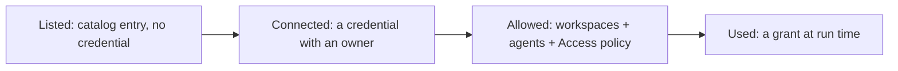

# Settings: Connected apps, Integrations, Storage and app access

Draft for approval. Nothing here is built until a person approves it. It
changes where things live and what they are called, adds credential ownership
to app connections, and redesigns the Access policy view. It does not change
capability-broker semantics, policy precedence, lease limits or the
Vercel-not-available rule.

Requirement ids are local to this spec. Where it overrides an approved
criterion elsewhere, the conflict is named in § Conflicts.

## 1. Four concepts, four places

| Concept | Who uses it | Lives at | Holds |
|---|---|---|---|
| **Connected apps** | Agents, through MCP | Team › Connected apps (`/app/settings/apps`) | App catalog, the team's app connections, who may use each, Access policy, access requests |
| **Integrations** | buildd itself, for a team or workspace capability | Team › Integrations (`/app/settings/integrations`); per-workspace binding on the workspace page | GitHub App installs, the Vercel token for deploy checks |
| **Storage** | buildd, for files a team chose to keep in its own bucket | Team › Storage (`/app/settings/storage`) | Where agent run logs are kept (internally: evidence backends) |
| **Platform infrastructure** | The platform operator | Operator tooling only (Health › Operator and the platform-owner API) | Platform catalog rows, provider client registrations, platform bucket, telemetry |

- R-1: Every setting MUST fit exactly one row above. A credential entered on one page MUST NOT also be entered on another.
- R-2: The You group's page for MCP clients and runners signed in to buildd as the person MUST be named **Signed-in apps** (route `/app/settings/connections`, unchanged). "Connected apps" MUST mean only the Team page for apps agents use.
- R-3: No product copy MUST name a separate admin site or call operator tooling "Buildd Admin". Platform-only controls stay behind the operator check (`settings-audiences` § What stays out of team settings).
- R-4: The role editor's connector section, connector error messages and agent-facing hints MUST name the page "Settings › Connected apps", not "MCP connectors", "Connectors" or "Apps".

### Same provider, two roles

One provider can be both an Integration and a Connected app. They are two
records with two credentials, and each row says who uses it.

| Provider | As a Connected app (agents) | As an Integration (buildd) | Platform only |
|---|---|---|---|
| Axiom | Agents query the team's Axiom datasets | none | buildd's own telemetry export (env, never shown) |
| Vercel | Not available (no approved OAuth client) | Deploy checks in Health, deploy state in Release | none |
| GitHub | GitHub MCP app, if added | GitHub App: repos, PRs, checks | App registration |
| Cloudflare | none | Cloud runner account (stays on Runners, see D-4) | none |

- R-5: A provider row on one page MUST NOT read or reuse the other page's credential. When the same provider is set up on both pages, each row MUST carry one line naming the other ("Also used by buildd for deploy checks" / "Also connected for agents").
- R-6: Platform-only uses (telemetry, platform bucket, provider client registration state) MUST NOT appear on any team page.

## 2. Connected apps: catalog, connection, access

Three layers, kept apart in data, copy and UI:

- **Listed.** The app is in the team's catalog (built-in, platform or the team's own entry). Listing grants nothing and stores no credential.
- **Connected.** A credential exists, and buildd records who owns it.
- **Allowed.** The workspaces where it may be mounted, the agents (roles) that mount it, and the Access policy for what they may do.
- **Used.** The capability broker issues a grant per worker at run time (`capability-requests`). Unchanged by this spec.

### 2a. Credential ownership

| Kind | Who connects | Who it acts as | Who can use it | Stored as |
|---|---|---|---|---|
| **Team connection** | A team admin | The provider account the admin signed in with, recommended a service account | Agents of that team (and teams it is shared with) in allowed workspaces | Team secret, owner team |
| **Personal connection** | Any member | That person | Only work that person started; never other people's tasks | Secret scoped to the person and team |
| **Organization sign-in** | A team admin sets it up once | The organization's identity provider issues per-use tokens (assertion mode) | Same as a team connection | No stored user token |

- R-7: Every connection MUST record its kind, the buildd account that connected it, when, and the provider account identity when the provider returns one. The app row MUST show "Connected as <provider identity> by <name>".
- R-8: A person's OAuth sign-in MUST NOT become a team connection without an explicit choice. Connecting an app at team level MUST state, before the provider redirect, "Agents in the workspaces you allow will act as the account you sign in with. Use a service account if you can."
- R-9: A personal connection MUST NOT be mounted for a task the owner did not start, MUST NOT be shared to another team, and MUST NOT be visible to admins beyond "<name> has a personal connection".
- R-10: Personal connections MUST reach agents through the connector gateway only. Their token MUST NOT appear in any claim response, environment or file a runner receives.
- R-11: Team connections MUST move to the gateway for every http app with OAuth or header auth. Until an app is on the gateway, its row's details MUST say "Agents receive this app's key while they run." (see § Conflicts, C-5).
- R-12: When the person who made a team connection leaves the team, the connection MUST keep working and its row MUST read "Connected by <name>, no longer on the team", with Reconnect offered to admins.
- R-13: **Disconnect** MUST revoke the token at the provider when the provider publishes a revocation endpoint, then delete it locally. When it does not, the confirmation MUST say "Also remove buildd from your <provider> account settings." A failed revocation MUST NOT keep the local credential.
- R-14: No API response MUST return a connection's client secret or token material, encrypted or not.

### 2b. Who may use a connection

- R-15: A connection MUST be mounted only in workspaces where it is explicitly enabled, the same rule in the settings list, at claim and in the gateway. Moving to this rule MUST NOT drop an app from any workspace that mounts it beforehand.
- R-16: Inside an enabled workspace, only agents whose role lists the app mount it (`mcp-connectors-and-roles` § 2, unchanged). An app with no agent listing it MUST read "No agent uses this yet".
- R-17: Delegation MUST NOT widen access. A delegated task uses its own role's apps; an in-session subagent gets no app tools unless its own allowed tools name them.
- R-18: Sharing to other teams stays (team granularity, owner team's credential, owner-team admins only). It MUST be its own action in the app's details, never a scope option while adding. Its confirmation MUST say "Agents in <team> will use this connection. Its workspaces and agents are chosen by <team>." A failed share MUST show an error on that team's line.
- R-19: The access summary on each row MUST be one line: "<n> workspaces · <m> agents" (or "Not allowed anywhere yet"), expandable to the lists.

### 2c. Adding an app

Today "Custom connection" (creates a connection) and "Add an internal app to
your team's catalog" (creates a catalog entry) are two forms, and the scope
choice "This team / One workspace / All my teams" mixes ownership, workspace
access and sharing.

- R-20: There MUST be one **Add app** flow: name, URL, how it signs in (OAuth, key, none), then "Connect now" or "List only". Listing only creates a catalog entry; connecting also creates the connection, team-owned.
- R-21: The add flow MUST NOT offer a scope choice. Workspaces are chosen after connecting (R-15), defaulting to none unless the team set the catalog entry to "In every workspace"; sharing is R-18.
- R-22: A key-auth app MUST ask for the header name with the key. Saving a key MUST NOT fail for want of a header name the form never asked for.

### 2d. The list

Today it is one flat list (Neon, Supabase, Axiom, Context7 and the rest in
catalog order), with connected and not-connected apps interleaved.

- R-23: The list MUST group as **Connected** first, then **Needs attention** (sign-in expired, needs a key, refresh failed), then **Available** (listed, not connected), then **Not available** (admins only, last). An empty group is not rendered.
- R-24: On a phone (below 768px), an Available row MUST be one line: icon, name, a description clamped to one line, and one action. Connected rows add the access summary line (R-19). Details open on tap.
- R-25: Names are the provider's product name ("Neon", "Supabase", "Axiom", "Context7"). Descriptions say what agents can do, in one short sentence ("Query logs and traces", "Look up library docs").
- R-26: A failed catalog or connection load MUST render "Couldn't load apps." with Retry, never the empty state.
- R-27: A member sees the page read-only under `TEAM_MANAGED_LINE` (`settings-audiences` AC-6) and keeps **Request** on Available rows, plus **Connect for me** where personal connections are supported. No other permission sentence renders.

### 2e. Access policy

Today on a phone this is a long feed of per-app disclosures, four selects per
app, and a six-field exception editor, with select text in the mono face.

- R-28: The policy MUST open as one compact overview: one row per app with a non-default rule, reading e.g. "Axiom · Reads automatic, writes ask · 2 exceptions". Apps on defaults collapse into one line, "<n> apps use the defaults", with the defaults stated once: "Reads and queries: allowed if an agent uses the app. Writes and admin: ask a person."
- R-29: Tapping an app opens its detail (a sheet on a phone): the four levels Read, Query, Write, Admin with their effective value and where it comes from ("Default" or "Team rule").
- R-30: Exceptions for one workspace or agent MUST be listed under the app and added only through an explicit "Add exception" action. The editor is closed until then and is scoped to the app already open, so it does not ask for the app again.
- R-31: Policy semantics MUST NOT change: most specific rule wins, ties go to the most restrictive, write and admin never auto-allow, leases cap at 24 hours, a grant made by policy ends when policy tightens, and the default effect is unchanged.
- R-32: Policy copy MUST NOT mention credentials or who connected an app; ownership is § 2a's, access is this section's.
- R-33: Select triggers on this page MUST use the UI typeface, not the mono face, with values in sentence case ("Ask a person", "Up to 4 hours"). Mono stays for counts and durations shown as data.
- R-34: The pending requests list stays first and never folds (unchanged).

## 3. Integrations

Today the page opens with Vercel's token form expanded (label, token, Store
token) whenever no token exists, above Evidence storage, and the Vercel copy
sends the user to a Health control that does not exist.

- R-35: The page MUST list **Connected** services first, each one row: name, what buildd does with it, when it was last used or checked, and the error if the last use failed.
- R-36: Services not set up MUST collapse to an **Add a service** list, one line each with its capability ("Vercel: deploy checks in Health and deploy state in Release"). Credential fields MUST render only after **Connect** on that service.
- R-37: The Vercel row MUST state what the token is for in one sentence and MUST NOT tell the user to go to a page that has no matching control.
- R-38: Linking a Vercel token to a workspace's project MUST happen on that workspace's page (Delivery › Release): a project id and a choice among the team's existing Vercel tokens, with a link to Integrations when none exists. The workspace page MUST NOT take a second token.
- R-39: The workspace preview bypass for visual review stays a workspace secret mapped in the workspace's git settings. It MUST NOT move to Integrations.
- R-40: Integrations MUST show the active team only, with no in-page team picker. A person on several teams switches team the way every other Team page does.
- R-41: The workspace page section that holds only the work tracker MUST be named "Work tracker", not "Integrations".

## 4. Storage

- R-42: Storage MUST be its own Team page, because a team can configure it. Its subject line is "Where agent run logs are kept: command output, test reports, CI logs and transcripts behind each task's checks."
- R-43: With no bucket set, the page MUST read "buildd keeps them for 30 days." as a state with an **Use your own bucket** action. "buildd managed" MUST NOT be a provider a team picks.
- R-44: The page MUST say screenshots and attached files are kept by buildd, so a team does not assume its bucket holds them.
- R-45: User-facing copy says "run logs" or "storage". Code, API, schema and verification keep the word **evidence** with its current meaning (`evidence_objects` kinds, the Evidence tab, reviewer evidence). Renaming internals is out of scope.
- R-46: A bucket row MUST show its status (verified, failing with the last error, not checked yet) and the workspace it covers or "Team default".

## 5. Permissions and states

| Page | Change it | Read it |
|---|---|---|
| Connected apps: connect, enable, share, policy, approve | `manage_connectors` | Any member |
| Connected apps: personal connection | The person themself | Admins see that it exists |
| Integrations: GitHub | `manage_github_installation` | Any member |
| Integrations: Vercel token | `manage_team_credentials` | Any member (never the value) |
| Workspace › Release: Vercel project link | `manage_workspace_settings` | Workspace members |
| Storage | `manage_evidence_backends` | Any member |

- R-47: Every page above MUST have a distinct empty, connected, needs-attention and load-error state, each with one action or none. No state shows a disabled control.

## 6. Routes

| Path | After this spec |
|---|---|
| `/app/settings/apps` | Team › Connected apps (label change, same route) |
| `/app/settings/connections` | You › Signed-in apps (label change); query keys `connected`, `error`, `request`, `reconnect` keep redirecting to `/app/settings/apps` |
| `/app/settings/connectors` | Redirects to `/app/settings/apps` (unchanged) |
| `/app/settings/storage` | Becomes the Storage page; its `PAGE_MERGES` redirect to Integrations is removed |
| `/app/settings/integrations#storage` and the `storage` legacy anchor | Redirect to `/app/settings/storage` |
| `/app/settings/github` | Redirects to `/app/settings/integrations` (unchanged) |

- R-48: The connector OAuth callback MUST land on `/app/settings/apps` in one redirect.

## Acceptance criteria

- AC-1: WHEN `SETTINGS_NAV` is read THEN You holds "Signed-in apps", Team holds "Connected apps", "Integrations" and "Storage", and no item is labelled "Apps".
- AC-2: WHEN product copy and agent-facing connector messages are scanned THEN none names "MCP connectors" as a settings page, "Buildd Admin", or a separate admin site.
- AC-3: GIVEN an admin connects Axiom for the team THEN the confirmation shows the service-account sentence before the redirect, and the stored connection records kind team, the admin's account and the provider identity.
- AC-4: GIVEN a member connects Axiom for themselves WHEN a task started by another member runs with a role that lists Axiom THEN Axiom is not mounted from that personal connection.
- AC-5: GIVEN a personal connection WHEN any claim response for its owner's task is inspected THEN it holds no token for that app, only a gateway entry.
- AC-6: GIVEN a team connection enabled in no workspace WHEN a task in any workspace claims with a role that lists it THEN it is not mounted.
- AC-7: GIVEN the set of apps each workspace mounts before the change WHEN explicit enablement ships THEN the next claim in each workspace mounts the same set, and the settings list shows each as enabled.
- AC-8: GIVEN a provider with a revocation endpoint WHEN an admin disconnects THEN the provider revocation is called and the local credential is deleted; GIVEN the call fails THEN the local credential is still deleted and the row says so.
- AC-9: WHEN `POST /api/connectors` creates or returns a connector THEN the body contains no client secret field.
- AC-10: GIVEN team A shares an app to team B WHEN B's admin opens it THEN it reads "Shared by A" and B can choose workspaces but not edit the connection; GIVEN the share call fails THEN the row shows the error.
- AC-11: WHEN the Add app flow renders THEN it shows no "This team / One workspace / All my teams" choice; GIVEN "List only" THEN a catalog entry exists and no connection or secret does.
- AC-12: GIVEN a key-auth app WHEN an admin saves a key through Add app THEN it saves with the header name entered in the same step.
- AC-13: GIVEN Neon connected, Axiom needing a key, Supabase and Context7 listed, and Vercel not available WHEN an admin opens Connected apps THEN groups render in order Connected (Neon), Needs attention (Axiom), Available (Context7, Supabase), Not available (Vercel); a member sees no Not available group.
- AC-14: GIVEN a 390px viewport WHEN Connected apps renders four Available apps THEN each row is one line tall plus padding, and no row shows a URL.
- AC-15: GIVEN the catalog request fails THEN the page shows "Couldn't load apps." with Retry, not "No apps."
- AC-16: GIVEN a member WHEN they open Connected apps THEN `TEAM_MANAGED_LINE` shows once, Request is offered on Available rows, and no other permission sentence renders.
- AC-17: GIVEN nine apps on defaults and one with a team rule WHEN Access policy renders on a phone THEN it shows one row for that app and one "9 apps use the defaults" line, and no select is visible until an app is opened.
- AC-18: GIVEN an app's detail is open WHEN no exception is being added THEN no exception editor field renders; WHEN "Add exception" is tapped THEN the editor opens without a provider field.
- AC-19: GIVEN the policy fixtures used by `capability-requests` AC-2 to AC-4 WHEN evaluated before and after this change THEN every effect, lease cap and grant outcome is identical.
- AC-20: WHEN the Access policy page renders THEN no select trigger on it has the mono class.
- AC-21: GIVEN a team with GitHub connected and no Vercel token WHEN Integrations renders THEN GitHub is a Connected row, Vercel is one line under Add a service, and no token input exists until Connect is tapped.
- AC-22: GIVEN a Vercel token exists WHEN an admin opens a workspace's Release section THEN they can link a Vercel project and pick that token, and no token input renders there.
- AC-23: GIVEN two teams WHEN a person on both opens Integrations THEN it shows only the active team's services and no team picker.
- AC-24: WHEN `/app/settings/storage` is requested THEN the Storage page renders (no redirect); WHEN `/app/settings/integrations#storage` is opened THEN it lands on Storage.
- AC-25: GIVEN no bucket THEN Storage reads "buildd keeps them for 30 days." with Use your own bucket, and the provider picker has no "buildd managed" option.
- AC-26: GIVEN the Evidence tab and verification code WHEN this change ships THEN their identifiers, API fields and kinds are unchanged.
- AC-27: GIVEN Axiom connected as an app WHEN Integrations renders THEN no Axiom row appears there, and no page shows buildd's own telemetry setting.
- AC-28: Phone (390px) and desktop screenshots of Connected apps (admin and member), Access policy, Integrations and Storage, in both themes, are attached to each implementation PR.

## Conflicts with approved specs and code

Each needs a person's call, or the named spec revised in the same PR that
builds this.

- C-1 (naming): `settings-audiences` and `mcp-connectors-and-roles` § 5c define You › "Connected apps" as apps signed in to buildd and Team › "Apps" as agent apps. R-2 swaps the meaning. Both specs change with the implementation.
- C-2 (admin surface): the task asked for "Buildd Admin". The approved specs ("Operator surface is an API, not a team UI"; `settings-audiences` AC-12) forbid naming a separate admin site in the product. This spec keeps operator tooling unnamed (R-3).
- C-3 (personal connections): `mcp-connectors-and-roles` § 1 puts per-user connectors out of scope. § 2a brings them in, gateway-only.
- C-4 (workspace default): R-15 and D-5 restate `mcp-connectors-and-roles` AC-12 ("not enabled means not mounted") for every boundary and make a new connection start in no workspace. Code details are in the task's private notes.
- C-5 (tokens on runners): `mcp-connectors-and-roles` AC-15 delivers an OAuth app's bearer token at claim; `credential-isolation` lists the Codex env case as a known gap. R-10 forbids that for personal connections at once; R-11 moves team connections to the gateway and discloses the gap until then.
- C-6 (typography): the shared `Select` trigger is mono app-wide, while `docs/design/design-system.md` reserves mono for counts, ids and durations. R-33 covers this page; changing the primitive is a separate decision.
- C-7 (storage page): the settings cohesion report merged Storage into Integrations as "one row". R-42 splits it back out because it is the one configurable storage setting and it is not a service buildd signs in to.
- C-8 (Cloudflare): the Cloudflare token powers the cloud runner and stays on Runners (D-4). The Models page's "Add one under Cloudflare" points to no page of that name and MUST say "Settings › Runners".

## Decisions to confirm

- D-1: Team › Connected apps and You › Signed-in apps (R-2).
- D-2: Storage as its own Team page (R-42).
- D-3: Personal connections are in scope, gateway-only, limited to the owner's own work (§ 2a).
- D-4: Cloudflare stays on Runners, not Integrations.
- D-5: Workspaces default to none for a new connection (R-21), with existing setups backfilled (AC-7).

## Delivery order (after approval)

1. Labels, routes, Storage page, Integrations layout and Vercel project link (§ 1, 3, 4, 6). No data change.
2. Connected apps list grouping, mobile rows, load error, one Add app flow (§ 2c, 2d).
3. Access policy overview and detail (§ 2e). UI only; AC-19 guards semantics.
4. Ownership recording, revocation, explicit workspace enablement with backfill (§ 2a, 2b).
5. Personal connections and moving team connections to the gateway (R-10, R-11).

## Code surface (today)

- Nav and routes: `apps/web/src/lib/settings-nav.ts` (`SETTINGS_NAV`), `apps/web/next.config.mjs` (`SETTINGS_ROUTE_MOVES`, `PAGE_MERGES`).
- Connected apps: `apps/web/src/app/app/(protected)/settings/apps/page.tsx`, `.../settings/connections/connectors/TeamAppsSection.tsx`, `AddConnectionModal.tsx`, `AddTeamEntryForm.tsx`, `SharingDialog.tsx`, `AgentAccessSection.tsx`, `apps/web/src/lib/team-apps-view.ts` (`buildTeamApps`), `apps/web/src/lib/connector-catalog.ts` (`CONNECTOR_CATALOG`).
- Connection custody: `apps/web/src/app/api/connectors/route.ts`, `.../api/connectors/[id]/connect/route.ts`, `.../api/connectors/callback/route.ts`, `.../api/connectors/[id]/disconnect/route.ts`, `apps/web/src/app/api/workers/claim/mcp-connector-injection.ts`, `apps/web/src/lib/connector-gateway.ts`.
- Policy: `apps/web/src/lib/capability-grants.ts` (`effectivePolicy`, `defaultEffect`), `apps/web/src/components/ui/Select.tsx` (`triggerClasses`).
- Integrations and storage: `.../settings/integrations/page.tsx`, `.../settings/VercelSection.tsx`, `.../settings/integrations/StorageSection.tsx`, `.../settings/workspace/[workspaceId]/ReleaseSection.tsx`, `apps/web/src/lib/health-watcher.ts`.

## Out of scope

- Capability-broker semantics, policy precedence, lease limits and default effects.
- Getting Vercel's OAuth client approved (`mcp-connectors-and-roles` § 5a).
- Renaming internal "evidence" identifiers.
- Model provider keys (Models and Keys pages).
- Visual design beyond the layout and type rules named here.
