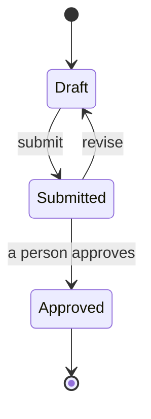

# Living Specs over MCP

A Living Spec is governed intent stored in buildd: a body with immutable
revisions, requirement ids (`R-n`, `AC-n`, `D-n`, `I-n`) parsed from it, and
one revision a person approved. Work pins an approved revision and is judged
against its criteria. Every call below is `buildd action=manage_specs` with
the sub-action in `params.action`. On the group tools it is
`buildd_artifacts` action `manage_specs`, listed on that tool's `More:` line.

A read-only session (a `tasks:read` grant) can call the reads: `list`, `get`,
`diff`, `history`, `read_ref`, `outcome`, `comments`, `attachments`,
`awaiting_approval`, and `metadata` without `changes`. Every other sub-action needs write access and is refused
with `requiredScope`.

This is not the `spec-sync` skill. `spec-sync` keeps a repo's own spec files
(`docs/SPEC.md`, `docs/specs/`) in step with the code. A Living Spec lives in
buildd, not in a repo file.

## When to make one

- **Living Spec:** intent a person approves, usually before work is built
  against it (or after, see Building ahead of approval), with criteria someone can grade (a feature, a contract, a product area).
- **Task:** a unit of work. If it needs a spec, file it against one (below).
- **Artifact:** a deliverable or report (`create_artifact`). It has no
  approval and no criteria.
- **Repo spec file:** the repo already keeps its contracts in Git and the
  owner wants them there. A Living Spec can cite one at a commit with
  `repoRefs`; it does not replace it.

Asked to "spec this"? Look for an existing spec first: `list` (below), and
`recall query="<topic>" scope=["spec"]`, which finds approved revisions only
(drafts are left out).

## The loop

1. **Find:** `buildd action=manage_specs params={ action: "list" }`, then
   `buildd action=manage_specs params={ action: "get", specId }`. `get` shows
   the version, the head and approved revisions, requirement ids, any design
   and cited repo files. A body over 20,000 characters is not inlined: read it
   with `get_artifact` views (`outline`, then `section` or `grep`).
2. **Draft:** `buildd action=manage_specs params={ action: "create_draft", title, body, scope, parentSpecId, changeSummary, repoRefs, design }`.
   Only `title` and `body` are required. `scope` is `product`, `domain` or
   `feature` (default); `mission` is retired, because a mission selects an
   existing spec (`manage_missions update outcomeSpec`) and never has one
   written for it. Write each criterion as a line starting
   `R-n` or `AC-n`. A criterion may carry a line `check: <command>` (buildd
   runs it at each PR head and records the exit code) or
   `screen: <id>, <id>` (screens of the design it covers).
3. **Revise:** `buildd action=manage_specs params={ action: "revise", specId, expectedVersion, body, changeSummary, explanation }`.
   `expectedVersion` is the version `get` showed. To replace one section,
   add `section` (an outline id) or `heading` (a heading used once) and send
   only that section's text, heading line included. To change one phrase,
   send `find` (exact text, once in the body) and `replace` instead of `body`. Omitted `repoRefs` or
   `design` carry forward; `[]` or `null` clears.
   **Write an explanation with every revise** (and with `create_draft`):
   `explanation: { summary, lines }`, `summary` one line on what the
   revision does, `lines` one plain line per criterion you added, changed or
   removed, keyed by its id (`"R-3"`), and one per section whose other text
   changed, keyed by its heading (`"Out of scope"`). Run `diff` first and
   cover every change it lists. The approval page checks the keys against the
   real change, with no model: a change you leave out is listed "Not
   explained" and the person must open it before Approve works; a line for
   something that did not change is listed apart. The explanation is fixed
   with its revision: a revise that only sends a new one is refused (a 409
   with code explanation_immutable). Say what changed and why, plainly; the check
   only proves you mentioned it.
4. **Submit and approve: a person's act.** `buildd action=manage_specs params={ action: "submit", specId, expectedVersion }`
   and `buildd action=manage_specs params={ action: "approve", specId, revision, expectedVersion }`
   return 403 to an agent run or API key. From a person's own OAuth session,
   `approve` approves nothing. First a quality gate checks the revision; if
   it passes, buildd notifies the person (their team's Pushover or webhook)
   and the reply says `Sent to <name> to confirm; gate passed` with the link
   to a confirm page showing what changed, the gate result and one Approve
   button. Hand the link on, tell them what changed (`diff`, below) and stop.
   The gate **refuses**, with reasons and no link, when: an id you
   already had now means something else (a rewording is fine; a new meaning
   needs a new id and a `replaces:` line), an id is defined twice or a retired
   id is back, an `AC-n` has neither a `check:` line, `screen:` line nor a
   GIVEN/WHEN/THEN with an observable result, or the design or a binding
   attachment is pinned to a version that no longer exists. Fix it in a new
   revision and ask again. It only **warns** on a missing change summary, a
   revision over 400 changed lines, or criteria removed with no
   `replaces:` and no mention in the summary. Never tell the person to
   override: only they can, on the confirm page, with a reason that is
   recorded on the approval with how it was approved (`mcp`, `chat` or
   `dashboard`).
   Several revisions waiting? `buildd action=manage_specs params={ action: "awaiting_approval" }`
   (read-only) gives the count and the person's inbox link, where they
   review and approve each one with a click. Hand that link on too. An API
   key's 403 names the same link.
5. **Pin:** file work with `create_task` and
   `context: { specSource: { specId, criteria, revision } }`. The server pins
   the approved revision itself. `criteria` (optional, 1 to 50 `R-n`/`AC-n`
   ids) narrows what the task answers for; left out, it answers for all of
   them. The first claim re-pins to the revision approved then; after that
   the pin never moves. Building ahead of approval: see below.
6. **Build:** read the pinned revision, not the head:
   `buildd action=manage_specs params={ action: "get", specId, revision }`.
   Later revisions are proposals until a person approves them.
7. **Outcome:** `buildd action=manage_specs params={ action: "outcome", taskId }`
   lists each criterion's verdict on the current PR head. `verified` only
   when every criterion passes there; `fail` when one fails; otherwise
   `unverified`. It is advisory: it never blocks completing or merging.
8. **Verdict (reviewers only):** `buildd action=manage_specs params={ action: "verdict", taskId, criterionId, verdict, headSha, evidenceRefs, observed }`.
   `verdict` is `pass`, `fail`, `inconclusive` or `unsupported`. A task cannot
   grade itself: its own token gets a 403. The reviewer of its PR, or a
   person, records verdicts. A visual audit adds `checker: "visual"` with
   `capturedSha` and `screenshotIds` in place of `headSha`.
9. **Conflict:** two criteria of an approved revision that disagree:
   `buildd action=manage_specs params={ action: "conflict", specId, revision, criterionIds, note }`.
   It records an advisory discrepancy and blocks nothing.

To request the registered checks on a task's current target, call
`buildd action=manage_specs params={ action: "verify", taskId, evidenceRef? }`.
`evidenceRef` is a stored capture's artifact UUID; omit it and the server picks
the newest captures the mission's [surface audit] stored for this task.
It needs workspace write access; a task never requests grading of its own
outcome, so the subject's token and tasks filed under it are refused.
It cannot choose a method, model, prompt, head or verdict, or submit raw evidence.
A mission's final verification runs the same coordinator on the integrated target.
It reads the pinned revision's `verify:` bindings and admits only an audit's own,
unedited capture of the current commit. A refused capture, missing capture or
provider failure records nothing, so the criterion stays unverified.
Declaration coverage says which requirements name checks; it does not mean they passed.

## Tables and diagrams

The spec page renders GitHub Markdown tables, and fenced code blocks tagged
`mermaid` as diagrams. Pick the shape by what the text does:

- **Table:** comparing options, states, roles or permissions. Criteria may
  live in one: a row whose first cell is an `R-n`/`AC-n` id defines that
  criterion, its text the row's other cells.
- **Diagram:** a flow, a state machine or a sequence (`flowchart`,
  `stateDiagram-v2`, `sequenceDiagram`).
- **Prose:** everything else.

A criteria table:

```markdown
| Id   | Role   | Can approve | Can revise |
| ---- | ------ | ----------- | ---------- |
| R-1  | Owner  | yes         | yes        |
| AC-1 | Member | no          | yes        |
```

A state machine:



A draft with three or more numbered steps and no diagram, or three or more
parallel list lines (`- X: a / b / c`, `- **X**: ...`) and no table, gets a
`Tip:` line in the `create_draft` or `revise` reply. It is a suggestion: the
draft is written as sent either way.

## Building ahead of approval

A person may ask for work to be built before the spec is approved. That is
allowed, and buildd keeps it honest:

- File the task against the spec as usual. With no approved revision (or
  naming a draft `revision`), the pin is provisional: that exact revision and
  its hash, marked `provisional: true`. With no revision named it pins the
  head. Do not leave the spec out of the filing to get past anything.
- The PR says "Built ahead of approval, against revision N". Say the same in
  your own words. Do not write that the work waits on approval, or that it
  contradicts the approve-first loop: it is the loop, in a different order.
- When a person approves revision M, every provisional pin moves to M and is
  re-graded there: check lines rerun at the PR head, a verdict carries over
  only where the criterion's text did not change, the task gets a note with
  the N-to-M diff, and the PR text says which revision was approved.
- Merged provisional work that nobody approves within 3 days shows in Needs
  You as "Work shipped against an unapproved spec".
- Work already finished without a pin: a person (or an admin token) attaches
  it with `buildd action=manage_specs params={ action: "attach_provisional", specId, revision, taskIds }`.
  An agent run gets a 403: ask the person to do it, and name the revision
  the work was built against.

## A mission's outcome spec

A mission can answer to a spec as a whole, not just task by task. Only when a
person or the mission's filer chooses it:

- Select it: `manage_missions` update `outcomeSpec: { specId, revision?, criteria?, narrowedReason? }`.
  That adds one required goal criterion pinned to the revision (the approved
  one, else the head, provisional). Running it again with the same input
  changes nothing. The pin moves only when you name a revision. A spec that is
  only mentioned, cited or pinned by tasks is not selected.
- The mission then completes only when every in-scope criterion passes on its
  integrated result: the integration branch head on a mission-branch mission,
  or a trunk commit that holds every merged mission PR on a direct one. Every
  PR review passing does not count for this.
- When the build is done, buildd files one `[final verification]` task. Its
  token records verdicts with `manage_specs verdict { missionId, criterionId, verdict, headSha }`
  at the current target. A builder, fix or review token is refused. Read where
  it stands with `manage_specs outcome { missionId }`.
- A fail gets an explicit `[spec repair]` task; once it lands the target
  moves and the verification runs again. A criterion the new commits did not
  touch is re-affirmed with a new verdict that names the old one (`reaffirms`).
- Waiving a criterion, narrowing without a reason and removing the selection
  are refused for agents: a person decides those.

## Version conflicts

A stale `expectedVersion` writes nothing and the error names
`currentVersion`. Re-read with `get`, merge your change into that text, and
revise again with the new version. Never retry the same body blindly. A 409
that names no `currentVersion` (the body moved outside a revise) has no retry:
say so and stop.

## Duplicates (409 `spec_duplicate`)

`create_draft` compares each criterion and section of the draft with the
workspace's other specs, approved and draft, and the reply names the
criteria that matched.

- A clear duplicate is refused with 409 `spec_duplicate` naming the spec(s).
  Nothing is written. Read the named spec. Then either revise it instead,
  or create again with one of:
  - `supersedes`: the id of the spec this one replaces, or
  - `distinctBecause`: at least 10 characters saying why it is different.
  Both are recorded. Do not invent a reason to get past the check.
- An overlap only warns: the draft is created and the reply lists the
  overlapping specs. Check the shared criteria; consider a common parent.
- A matching draft only warns: nothing is in force yet.
- A check that could not run says so; the draft is still created.
- `revise` checks the criteria it adds or changes the same way. It only
  warns: the revision is written.

## Structure and neighbours

- One tree: product, then area (`domain`), then feature, by parent. An area
  is a spec with scope `domain`: a title and a one-paragraph charter. It is a
  parent from its first revision, approved or not.
- A draft with no parent comes back with a suggested parent, and after the
  reply buildd files it itself when it is sure: the spec page then says
  "Filed by buildd", with undo. Otherwise it only suggests a place. Set the
  parent yourself with
  `buildd action=manage_specs params={ action: "relate", specId, parentSpecId }`;
  `parentSpecId: null` clears it. A parent in another workspace, or one that
  forms a cycle, is refused. Relating does not change the version, and a spec
  you place by hand is never moved by buildd again.
- Organize a whole workspace:
  `buildd action=manage_specs params={ action: "organize", workspaceId, dryRun }`.
  `dryRun` defaults to true and writes nothing. With no product or area it
  proposes a taxonomy (areas with charters and the specs each would hold,
  and the specs it left for a person). The team's decision model sorts the
  specs when a measured one answers; otherwise a word-based fallback does,
  and the reply says which. `dryRun: false` creates it, `areas: [keys]` and
  `edits: { [key]: { title, charter } }` accept part of it or rename. With
  areas it sweeps the unfiled specs into one batch grouped by area; with
  `dryRun: false` the confident ones are filed (each with undo) and the rest
  stay suggestions. Run the dry run first and show it to a person before a
  taxonomy is created.
- Neighbours (similar specs, specs whose work touched the same files,
  criteria judged to overlap) show on the spec page under Related. They are
  information: they approve, pin, grade and block nothing.

## Repo files and designs

- `repoRefs: [{ path, commitSha }]` cites a repo file at a full 40-character
  commit SHA. A branch name, a short SHA or a missing file is a 400.
  Read a cited file at its commit:
  `buildd action=manage_specs params={ action: "read_ref", specId, path, view }`
  (`view` as `get_artifact`: `outline`, `section`, `range`, `grep`, `meta`,
  `full`).
- `design: { kind, ref, version, screens }` names what the revision is built
  to. `kind` is `artifact` (default: an artifact in the workspace, such as an
  HTML prototype or images, pinned to its current revision), `url` or
  `figma`; `url` and `figma` need `version`. Figma is one kind among several,
  not the default.
- Pin a design as a buildd design artifact at a revision:
  `design: { kind: "artifact", ref: <artifactId>, version: <revision> }`.
  Every runner can read that. A claude.ai canvas URL (`kind: "url"`) can be
  read only by a session signed in to claude.ai: store the canvas as a design
  (below) and keep its URL in the artifact's `metadata.source`.

### Storing a design

A design (an HTML export, a prototype, images) is a file artifact. Store it
with `upload_artifact`, never by pasting it into `create_artifact`: a large
export is far too many tokens for a tool call. One call, no worker needed:

```
buildd action=upload_artifact params={ filename: "nav.html", mimeType: "text/html",
  sizeBytes, missionId (or specId / initiativeId),
  metadata: { kind: "design", screens: [{ id: "home", name: "Home", viewport: "1440x900" }] },
  attach: [{ subjectKind: "mission", subjectId }] }
```

Run the `curl` PUT it returns, then `upload_artifact { artifactId }` to
verify the bytes; the `attach` links (a design reference unless `relation`
says otherwise) are written then. Screen ids are letters,
digits and `. _ / : # -`; `viewport` is `WIDTHxHEIGHT`. Bad screens are
refused with the field named. You need write access to the scope: an owner or
admin session, or a worker whose task is in it.

A re-export is a new revision of the same artifact, not a new artifact:
`upload_artifact { artifactId, filename, mimeType, sizeBytes }`, the PUT, then
`upload_artifact { artifactId }`. Links that follow the current body move to
it; pinned links and a spec's `design` with a `version` stay. Read an earlier
one with `get_artifact { artifactId, revision }`.

### From a Claude Design canvas

In the buildd repo, `scripts/design/export-canvas.ts` turns a canvas's files
into one design: every board a screen with an id and viewport, links between
boards working, `metadata.screens` filled in. Get the files with the Artifact
tool (an owner session, or a worker given `claudeAiArtifacts: 'read'`):
`list scope=files`, then `read path=project/canvas.json` and each
`project/<Board>.dc.html`, into a temp dir. A worker with no Artifact tool
asks a person to copy them in. Pass `--source <canvas url>`; `--upload
--mission <id>` stores it (`--artifact <id>` for a new revision).
Steps: `scripts/design/README.md`.

## Attachments

A spec can carry files beside its text: mockups, screenshots, diagrams as
images, notes.

- **Attach or write it in?** Write it in the body when it is words a
  criterion can quote: a rule, a list of states, a table of options. Attach it
  when it is a picture or a file the words point at (a mockup, a screenshot,
  an exported diagram, a research note). A spec whose criteria only make
  sense with the image needs the image attached as `binding`.
- **Kind:** `binding` when the requirements depend on it. Approving records
  its version, and the spec shows "changed since approval" when it moves on.
  `reference` for notes, research and screenshots of today's behaviour. It is
  never approved or graded.
- Attach an artifact already in the workspace:
  `buildd action=manage_specs params={ action: "attach", specId, name, kind, caption, artifactId }`.
  Or upload a file in one call: replace `artifactId` with `filename`,
  `mimeType` and `sizeBytes`, then run the `curl` PUT the reply gives.
  `name` is lower case (`a-z`, `0-9`, `.`, `_`, `-`); a live name is unique,
  and `replace: true` puts a new file under it.
- Place it inline with ``. It renders on the
  spec page, the approval page and the diff's rendered view, from a buildd
  link that checks access on every read. A name that is not attached shows
  as missing.
- It belongs to the revision it was added in. Removing one (on the spec page)
  stops it from a later revision; older revisions keep it.
- Read them: `buildd action=manage_specs params={ action: "attachments", specId, revision }`
  lists each with its artifact id. Read one, an image included, with
  `buildd action=get_artifact params={ artifactId }`.

## Importing repo spec files

A workspace's `docs/specs/*.md` can become native specs, filed under the area
each file's `domain:` names, with the path, the commit and the PR that last
changed it recorded.

- Look first: `buildd action=manage_specs params={ action: "import" }` is a
  dry run. It writes nothing and lists, per file, the spec it would create,
  its area, its provenance, any duplicate of an approved spec, and the files
  it skips with a reason (`SPEC-FORMAT.md`, `INDEX.md`, superseded, already
  imported). `ref` reads another branch or commit; `paths` limits it.
- Write:
  `buildd action=manage_specs params={ action: "import", dryRun: false }`.
  Revision 1 is imported, not approved; the frontmatter leaves the body, its
  mechanical fields and summary going to the metadata block. Per file the
  reply lists the criterion ids the parser could not read (AC-3a, AC-AQR-1,
  INV-2) and ids defined more than once; the import goes ahead and records
  them on the spec, whose page and `get` say how many could not be read. Fix
  the file and import again. Running it again with no repo change imports nothing;
  a changed file becomes a new imported revision. A duplicate is skipped
  unless you name it in `allowDuplicates` after reading the spec it
  duplicates.
- Until a person confirms, the repo file is the source: `revise` and
  `approve` are refused with a 409 (code spec_imported) and no repo copy is
  written. Change the file and import again instead.
- Confirming is a person's act:
  `buildd action=manage_specs params={ action: "confirm_import", specIds }`
  approves each spec whose file is unchanged since its imported commit and
  reports the rest stale. From an agent run or API key it is a 403; from an
  OAuth session it returns the specs page link. Hand that link to the person.

## Reading changes

`buildd action=manage_specs params={ action: "diff", specId, from, to }`
lists the criteria added, changed, removed, moved and replacing (by id, the
changed words marked), the other text by section, and one line when the
change summary names ids the list does not hold or misses ids it does. Then
sections added, removed and changed, and a capped line diff with a count of
what it left out. `to` defaults to the head; `from` to the approved revision.
Use it before asking a person to approve, and when a pinned task sees a newer
approved revision.

## Criteria have a history

Each criterion is kept per revision with a hash of its words.

- `buildd action=manage_specs params={ action: "history", specId, criterionId }`
  lists every revision in which its words changed, with the change summary,
  who wrote it and whether that wording was approved.
- A verdict counts only for the words it judged: after a revision changes a
  criterion, an older pass reads "passed an earlier wording".
- An id is never reused. A revise that gives a retired id new words is
  refused, naming the revision that retired it: pick the next free id.
- A criterion that replaces others says so on a line under it:
  `replaces: R-26` (or `replaces: R-26, R-27`). Review lists it as replacing
  them, and its history continues theirs. Write the summary with the ids it
  changes: Review checks the summary's ids against the change list.

## Comments

- Add: `buildd action=manage_specs params={ action: "comment", specId, criterion, body, revision, replyTo }`.
  Anchor on one `criterion` (an `R-n`/`AC-n` id), or on a `section` (outline
  id) or `heading` instead. A comment never changes the spec.
- Read: `buildd action=manage_specs params={ action: "comments", specId, revision }`.
  Each reads `open` (anchor unchanged), `outdated` (anchor changed) or
  `resolved`. Only a person resolves one, on the spec page.

## Metadata

A spec's metadata block (verified_by, surfaces, last_verified, assertions,
owner) sits outside every revision: changing it needs no
approval and moves neither the version nor the approved hash.

- Read: `buildd action=manage_specs params={ action: "metadata", specId }`.
- Change: `buildd action=manage_specs params={ action: "metadata", specId, changes: { verified_by: [...] }, reason }`.
  `reason` is required and recorded with who changed it and the previous
  value. `domain` is not a field: it comes from the spec's area.

## Retiring

A spec is retired, never deleted. Retiring is a person's act: from an agent
run or API key it is a 403, so say what should be retired and why, and let
the person do it on the spec page. From the person's own OAuth session,
retire and restore change nothing, like approve: the reply is a confirm link
pinned to the spec, its version, its status and the reason. Hand it on and
stop; the person confirms it on buildd.dev, and a spec that moved since is
refused as stale.

- Retire: `buildd action=manage_specs params={ action: "retire", specId, reason }`.
  Add `supersededBy` (a live spec in the same workspace) when another spec
  replaces it; the status is then superseded, else retired. `reason` (10+
  characters) is recorded with who did it in the metadata change log.
- A retired spec leaves the index counts and the import confirm list, and is
  no longer revised, approved or attached to.
- When a repo file stands for the spec, buildd opens one PR on it: an
  imported file is marked superseded in its frontmatter, naming what
  replaces it (body untouched), which a person merges; a generated copy is
  removed. The spec
  page names the PR until it merges.
- An import run lists an imported file that was deleted, or marked
  `status: superseded`, under Retire. Only `confirm_import`, a person's act,
  retires those specs.
- Restore: `buildd action=manage_specs params={ action: "restore", specId }`
  puts back the status it had. It opens no PR: the repo file still reads
  superseded.

## Another workspace's spec

Workspaces never read each other's specs. If `get` returns 404 for a spec you
were told about, it is not yours to read, and asking the owner again does not
change that. Another workspace's spec reaches this one only as a copy:

- `buildd action=manage_specs params={ action: "copy", specId, targetWorkspaceId, revision }`
  copies one revision as a draft in `targetWorkspaceId`, byte for byte. It
  needs one caller who reads the source and writes specs in the destination;
  a task token reaches only its own workspace, so a worker usually cannot,
  and should ask a person to run it (or to use an API key that reaches both).
- The reply is the handoff: the destination spec id, revision and sha256,
  re-read and checked against the source. Anything else, such as an owner's
  "yes, copy it" with no reply, is not a copy. A stale revision, an
  unreachable destination or an unverified write are refused by name.
- Copying never approves. A person in the destination approves the copy;
  until then pin it provisionally (`context.specSource { specId, revision }`).
- Once a copy exists, a `get` of the source id from the destination names
  it. Use that id. A retry of `copy` returns the same copy.
- Until a copy reply exists, hold the work that needs the spec blocked and
  ask once, naming the copy call above as the recovery.

## Never

- Never approve, or say a spec is approved, unless `get` shows that revision
  approved. Drafted, submitted and in review are not approved. Building
  ahead of approval does not approve anything either.
- Never call `attach_provisional` from an agent run; it is a person's act.
- Never call `confirm_import` from an agent run; confirming an import approves specs.
- Never call `retire` or `restore` from an agent run; ask the person.
- Never click, open or forward a confirm link as if you were the person.
- Never record a verdict on your own task, or a pass you did not observe on
  that exact head. Never record a mission-level verdict from a builder, fix
  or review task, or report a mission's outcome spec as verified from PR
  reviews.
- Never write a spec body through `update_artifact`; it is refused. Use
  `revise`.
- Never build against the head revision when the task is pinned to another.
- Never treat another workspace's spec as readable, or a copy as approved;
  build against the copy's id only once a `copy` reply names it.
- Never override a duplicate refusal without reading the spec it names.
